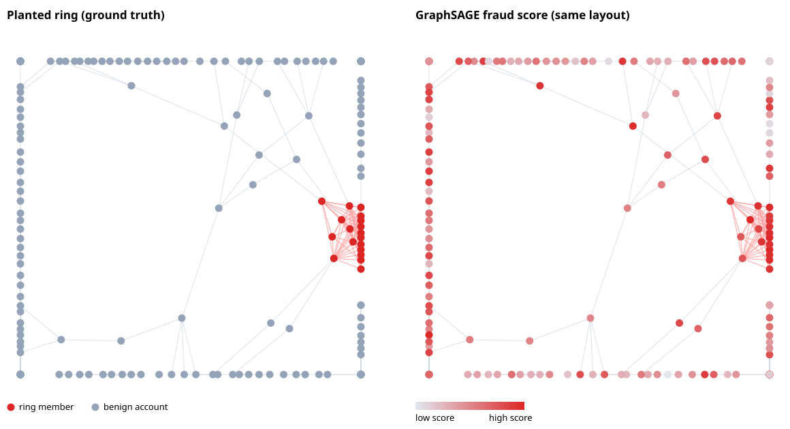

# GNN Fraud Ring Detection

[](https://colab.research.google.com/github/RishabhPande/GNN-fraud-ring-detection/blob/main/examples/quickstart.py)
[](https://doi.org/10.5281/zenodo.23749421)


[](https://github.com/RishabhPande/GNN-fraud-ring-detection/actions/workflows/tests.yml)
[](https://codespaces.new/RishabhPande/GNN-fraud-ring-detection)

**GraphSAGE and GAT from scratch in pure Python. Zero dependencies. Built to catch fraud rings.**

One-hop features miss fraud rings. A ring of mule accounts can look perfectly ordinary one account at a time: normal ages, normal balances, normal transaction sizes. What gives them away is the *wiring*: a dense pocket of accounts transacting with each other far more than chance allows.

This repo generates that pattern synthetically and learns it with graph neural networks implemented end to end: forward pass, backprop through message-passing layers, neighbor sampling, mini-batch SGD. Nothing but the standard library.

> **Disclaimer:** every account in this repo is synthetic. No real people, no real transactions, no real PII anywhere. The generator exists so GNN detectors can be built, tested, and benchmarked without touching sensitive data.

## Seed robustness at a glance

| Seed-robustness sweep | Result |
|---|---|
| GIN + LSTM, AUC/F1, seeds 7-9 | 1.000 |
| PNA, AUC/F1, seeds 7-9 | 1.000 |
| ChebNet / H2GCN, min AUC, seeds 7-9 | 0.944 |
| Mean aggregation, AUC, seed 8 | 0.728 |
| Mean aggregation, AUC, seed 9 | 0.539 |
| SGC, AUC, seed 9 | 0.411 |
| GATv2, AUC, seed 8 | 0.467 |

Test suite: 456 tests. Full per-seed table in Results below.

## Try it in 30 seconds

Click **Open in Colab** above, or run locally:

```bash
python examples/quickstart.py
```

Or as a library:

```python
from gnn_fraud import GraphGenerator, train_sage, train_val_split

g = GraphGenerator(seed=7).generate(n=200, ring_size=18)
train_ids, val_ids = train_val_split(g.labels, seed=7)
model, history = train_sage(g, train_ids, val_ids)
probs = model.predict(g, val_ids)
```

## Results

Seed 7, 200 accounts, 18 ring members. The graph signal is the whole story:

```
model                              thr precision  recall      F1     AUC
GraphSAGE (2-layer, mean agg)      0.28     1.000   0.750   0.857   0.978
GraphSAGE (2-layer, max-pool agg)  0.41     1.000   1.000   1.000   1.000
MLP (features only)                0.23     0.286   0.500   0.364   0.656
```



*Left: the planted ring (red) inside 200 synthetic accounts, seed 7. Right: the same layout with nodes shaded by GraphSAGE fraud-score rank (darkest red = highest score). The layout is force-directed and knows nothing about the labels: the ring clusters on its own because it is wired densely, while benign accounts scatter. That is the whole pitch in one picture: one account at a time the ring looks ordinary, and the wiring gives it away. Regenerate with `python examples/visualize_ring.py` (pure Python, no new dependencies; the script also prints the quickstart validation numbers it is drawn from).*

Same protocol with max-pool aggregation (`examples/pool_example.py`): each
neighbor is transformed through `relu(W_pool @ x_u + b_pool)` and the layer
keeps the elementwise max -- the single loudest tell per dimension, not the
neighborhood mean (the GraphSAGE paper's pooling aggregator, selected with
`aggregator="pool"`).

Same protocol with attention (`examples/gat_example.py`) and on a heterogeneous graph of accounts, devices, and merchants (`examples/hetero_example.py`):

```
GAT (2-layer, attention)            0.29     0.667   1.000   0.800   0.967
Relational GraphSAGE (hetero)       0.31     0.800   1.000   0.889   0.994
```

Same protocol with a GCN (`examples/gcn_example.py`; longer schedule --
100 epochs, patience 25, lr 0.5 -- because the normalized aggregation
shrinks gradients and SAGE's lr 0.1 underfits badly, AUC ~0.48-0.71):

```
GCN (2-layer, normalized)           0.31     0.500   1.000   0.667   0.944
```

GCN lands just under SAGE's mean model: the symmetric normalization
that defines it also dilutes the ring's own signal, since ring members
are the highest-degree nodes in the graph and their messages get
down-weighted the most. Still far above the feature-only baseline -- a
real architectural difference, not a tuning artifact, since both models
train at their own best learning rate.

Same protocol with an SGC (`examples/sgc_example.py`): delete the GCN's
hidden layer and ReLU, propagate the features twice through the
normalized adjacency, then logistic regression:

```
SGC (2-hop propagation)             0.28     0.500   1.000   0.667   0.928
GCN (2-layer, normalized)           0.31     0.500   1.000   0.667   0.944
MLP (features only)                 0.23     0.286   0.500   0.364   0.656
```

SGC lands within 0.016 AUC of the GCN it ablates, with the same F1:
on this graph the hidden layer buys almost nothing, and the propagated
features alone carry the signal. The cheaper, linear, easier-to-audit
model is the one to ship here.

Same protocol with a SIGN (`examples/sign_example.py`): concatenate
the 0-, 1-, and 2-hop propagated features and let a small MLP head
weight the hops, instead of SGC's single linear head over the 2-hop
block alone:

```
SIGN (0/1/2-hop concat + MLP)       0.25     0.500   1.000   0.667   0.956
SGC (2-hop propagation)             0.28     0.500   1.000   0.667   0.928
GCN (2-layer, normalized)           0.31     0.500   1.000   0.667   0.944
MLP (features only)                 0.23     0.286   0.500   0.364   0.656
```

SIGN edges SGC (+0.028 AUC) and the GCN (+0.012) with the same F1:
hop identity buys a little here, and the head's W1 column norms say
why, leaning hardest on the 2-hop block (4.291) over the 1-hop block
(3.839) and the raw features (2.620), so the deeper propagation
carries the ranking and the shallow views add the margin. The gain is
small, and the sweep shows it does not hold up across seeds (AUC
0.956/0.872/0.883, min 0.872), so hop identity buys a little on seed
7 and less elsewhere. Unlike H2GCN the mechanism is cheap: propagation is precomputed once, and
only the head trains.

Same protocol with APPNP (`examples/appnp_example.py`): predict first
with an MLP, then 10 personalized PageRank steps (teleport alpha 0.1)
over the predictions, instead of propagating the features and then
classifying:

```
APPNP (predict, then propagate)     0.19     0.444   1.000   0.615   0.928
SGC (2-hop propagation)             0.28     0.500   1.000   0.667   0.928
MLP (features only)                 0.23     0.286   0.500   0.364   0.656
```

APPNP ties SGC on AUC exactly and trails it slightly on F1: the
teleport does its job (10 propagation steps without washing the node's
own prediction out), but on this graph the order of operations does
not matter much, since both models end up ranking the same dense
pocket. The value is the mechanism, not the headline: where deep
propagation would oversmooth, APPNP is the safe way to run it.

Same protocol with a GPR-GNN (`examples/gpr_example.py`): an MLP
encoder, 10 rounds of normalized propagation of the hidden states,
and a learned weighted sum over the propagation steps -- the GPR-GNN
paper's generalization of APPNP's fixed PageRank coefficients:

```
GPR-GNN (learned gamma)             0.23     0.600   0.750   0.667   0.939
APPNP (predict, then propagate)     0.19     0.444   1.000   0.615   0.928
SGC (2-hop propagation)             0.28     0.500   1.000   0.667   0.928
MLP (features only)                 0.23     0.286   0.500   0.364   0.656
```

GPR-GNN edges APPNP on AUC (0.939 vs 0.928) and F1 (0.667 vs 0.615)
and ties SGC on F1 while edging it on AUC: learning the polynomial
beats fixing it, but only slightly on this graph. The learned gamma
is the interesting part: it peaks at the 1-hop term (0.604 vs the
0.090 init), decays smoothly through the middle steps to 0.021 at
k=9, and keeps a large deep term (0.278 at k=10), with no negative
coefficients -- so no high-pass behavior emerged here, and the gain is
reweighting toward the neighborhood, not a new filter shape. The
coefficients sum to 3.37, up from 1.0 at init: the head absorbs the
scale, so the shape is the finding, not the magnitude. One seed only,
like the other GCN-family headlines.

Same protocol with a BernNet (`examples/bern_example.py`): an MLP
encoder, then a Bernstein-polynomial filter of order K = 4 over the
hidden states, where each learned coefficient theta_k is the filter's
value at the k-th Bernstein point of the spectrum (lambda = 2k/K),
initialized to the linear low-pass theta_k = 1 - k/K (the operator
(I + S)/2):

```
BernNet (Bernstein filter)          0.35     0.800   1.000   0.889   0.994
GPR-GNN (learned gamma)             0.23     0.600   0.750   0.667   0.939
SGC (2-hop propagation)             0.28     0.500   1.000   0.667   0.928
MLP (features only)                 0.23     0.286   0.500   0.364   0.656
```

BernNet is the strongest of the propagation-polynomial family on
this graph (AUC 0.994 vs GPR-GNN's 0.939, F1 0.889 vs 0.667), and
its coefficients say why in frequency terms: theta_0 grows from 1.0
to 2.599 (the smooth, neighborhood-agreeing component is amplified
two and a half times) while every higher coefficient goes negative
(-0.282, -0.574, -0.224, -0.183 from lambda 0.5 up), so the learned
filter is a sharpened low-pass that does not just mute the
high-frequency bands but inverts them - a node that disagrees with
its neighborhood is pushed the other way, which is exactly the
bridge-account direction. Like GPR's gamma the coefficients' scale
is partly absorbed by the head, so the sign pattern is the finding,
not the magnitude. One seed only, like the other GCN-family
headlines.

Same protocol with a GIN (`examples/gin_example.py`):

```
GIN (2-layer, sum agg)              0.50     1.000   1.000   1.000   1.000
GraphSAGE (2-layer, mean agg)       0.28     1.000   0.750   0.857   0.978
```

GIN beats mean-SAGE outright here: sum aggregation keeps the
neighborhood *count* -- a ring member has a dozen ring neighbors,
a background account one or two -- which mean erases and GCN's
normalization dilutes. Learned eps stays near zero at lr 0.1
(layer1 -0.066, layer2 -0.029); lr 0.5 still ranks perfectly but
drives layer-2 eps to -2.19, so 0.1 is the default.

Multi-head GAT (`examples/multihead_gat_example.py`; longer schedule --
150 epochs, patience 40, lr 1.0 -- because the averaged final layer
splits each head's gradient K ways):

```
GAT (1-head)                        0.73     1.000   1.000   1.000   1.000
GAT (2-head)                        0.19     0.800   1.000   0.889   0.994
GAT (4-head)                        0.79     1.000   1.000   1.000   1.000
```

More heads match single-head ranking but buy nothing here: the four
heads learn nearly identical, near-uniform attention (mean pairwise
head L1/2 distance 0.022 on the top-scored ring member), so they
re-learn the same neighborhood mean four times instead of specializing.

With edge timestamps -- the ring's edges land in a 3-day burst at the end of a 30-day timeline -- recency-weighted aggregation (`examples/temporal_example.py`):

```
TemporalGraphSAGE (recency)         0.27     0.571   1.000   0.727   0.950
GraphSAGE (2-layer, mean agg)       0.28     1.000   0.750   0.857   0.978
MLP (features only)                 0.23     0.286   0.500   0.364   0.656
```

Inductive check: train on graph A, freeze the threshold, score a fresh graph B with no retraining. Ranking transfers (AUC 0.84 vs 0.98 transductive); calibration does not, so re-calibrate the threshold per deployment. See `examples/inductive_example.py`.

Edge classification on the same graph: freeze the GraphSAGE encoder, score each *flow* with an MLP head over endpoint-pair features (`examples/edge_example.py`):

```
EdgeHead (frozen SAGE embeddings)       0.48     0.857   1.000   0.923   0.951
```

A second fraud pattern -- money-mule chains (`examples/mule_chain_example.py`): originator -> 4 parallel mule chains -> consolidator -> exit. Thin paths, ~zero triangles, hop timestamps monotone downstream inside a late burst:

```
GraphSAGE (2-layer, mean agg)          0.40     0.800   1.000   0.889   0.978
GraphSAGE (2-layer, max-pool agg)      0.50     0.800   1.000   0.889   0.978
TemporalGraphSAGE (recency)            0.39     0.800   1.000   0.889   0.983
MLP (features only)                    0.60     1.000   0.500   0.667   0.856
```

A third fraud pattern -- smurfing / structuring (`examples/smurfing_example.py`): one source splits a large sum into small sub-threshold amounts routed through 16 smurf intermediaries to a single collector. Fan-out/fan-in, not density and not a path: the source and the sink are hubs, every smurf hangs off exactly those two, no triangles at all, hop pairs fast and late in a burst:

```
GraphSAGE (2-layer, mean agg)          0.30     0.750   0.750   0.750   0.933
TemporalGraphSAGE (recency)            0.57     1.000   0.750   0.857   0.939
MLP (features only)                    0.43     0.400   0.500   0.444   0.672
```

Seed robustness (`examples/seed_robustness_example.py`): the same dense-ring
protocol, fresh graph + split + initialization per seed, AUC/F1 per seed.
Panel 2 runs each model on its own per-model example schedule (100 epochs,
patience 25, lr 0.5 for the full-graph family; 60 epochs, patience 12 for
GATv2 and PNA):

```
model                          seed 7     seed 8     seed 9     mean  min
GraphSAGE (mean agg)           0.978/0.857  0.728/0.333  0.539/0.240  0.748  0.539
GraphSAGE (max-pool agg)       1.000/1.000  1.000/1.000  1.000/1.000  1.000  1.000
GraphSAGE (LSTM agg)           1.000/1.000  1.000/1.000  1.000/1.000  1.000  1.000
GIN (sum agg)                  1.000/1.000  1.000/1.000  1.000/1.000  1.000  1.000
GCN                            0.944/0.667  0.889/0.615  0.889/0.615  0.907  0.889
SGC                            0.928/0.667  0.883/0.571  0.411/0.229  0.741  0.411
APPNP                          0.928/0.615  0.867/0.500  0.894/0.615  0.896  0.867
GATv2                          0.978/0.889  0.467/0.235  0.689/0.364  0.711  0.467
JK-GCN                         0.972/0.800  0.889/0.615  0.911/0.667  0.924  0.889
ChebNet                        1.000/1.000  1.000/1.000  0.944/0.750  0.981  0.944
GCNII-4                        0.944/0.727  0.889/0.615  0.506/0.250  0.780  0.506
TAGCN                          0.961/0.800  0.906/0.615  0.894/0.571  0.920  0.894
PNA                            1.000/1.000  1.000/1.000  1.000/1.000  1.000  1.000
GPR-GNN                        0.939/0.667  0.811/0.375  0.822/0.471  0.857  0.811
MixHop                         0.961/0.800  0.889/0.533  0.867/0.571  0.906  0.867
H2GCN                          0.994/0.889  0.944/0.727  1.000/1.000  0.980  0.944
SIGN                           0.956/0.667  0.872/0.545  0.883/0.500  0.904  0.872
```

Mean is fragile, but no longer the only fragile one: SGC and GCNII-4
collapse on seed 9 (0.411, 0.506), GATv2 collapses on seed 8 (0.467),
and GCN, APPNP, TAGCN, SIGN, GPR-GNN, and MixHop all sit just under
the 0.90 bar on seeds 8-9. What holds across all three seeds is
specific: PNA at 1.000 everywhere, ChebNet and H2GCN never below
0.944, JK-GCN at 0.889-0.972, alongside the panel-1 survivors
max-pool, LSTM, and GIN. The survivors all keep a channel the
normalized neighborhood mix cannot wash out (count-aware towers,
an ego block, per-term weights, a layer-1 concatenation); the models
that only ever see a normalized mix inherit mean's fragility. Three
seeds is still a small sweep, so this is an observation about a
pattern, not a ranking.

Same protocol with a ChebNet (`examples/cheb_example.py`; longer schedule --
100 epochs, patience 25, lr 0.5, the GCN family's schedule):

```
ChebNet (2-layer, K=2)              0.50     1.000   1.000   1.000   1.000
GraphSAGE (2-layer, mean agg)       0.28     1.000   0.750   0.857   0.978
```

ChebNet matches the repo's best models on the dense ring and beats the
plain GCN (AUC 0.944) it is closest to: each layer mixes the 0-, 1-, and
2-hop Chebyshev terms with learned weights instead of one normalized hop,
so the ring's dense pocket survives without the hub down-weighting that
costs the GCN. One seed only, like the other GCN-family headlines.

Same protocol with a GCNII (`examples/gcnii_example.py`; input GCN layer
+ 4 GCNII layers, alpha 0.2, same 100-epoch schedule):

```
GCNII (input + 4 layers)           0.14     0.571   1.000   0.727   0.944
GCNII deep (input + 8 layers)      0.16     0.571   1.000   0.727   0.950
GCN (2-layer)                      0.31     0.500   1.000   0.667   0.944
GraphSAGE (2-layer, mean agg)      0.28     1.000   0.750   0.857   0.978
```

GCNII ties the plain GCN on AUC (0.944 both) and edges it on F1 (0.727
vs 0.667), while still trailing SAGE mean (0.978). The residual's real
payoff is depth: the 8-layer stack reaches 0.950 AUC instead of
collapsing the way a plain deep GCN oversmooths, because every layer
mixes back the input layer's representation and the identity-shrunk
weights keep the gradient alive. Alpha matters: the paper's 0.1 lands
just under 0.90 AUC here (0.894), 0.2 reaches 0.944. One seed only, like
the other GCN-family headlines.

Same protocol with a TAGCN (`examples/tag_example.py`; two layers,
K = 2 per layer, so up to 4 hops with a separate weight matrix per
hop, same 100-epoch schedule):

```
TAGCN (2-layer, K=2)                0.21     0.667   1.000   0.800   0.961
GCN (2-layer)                       0.31     0.500   1.000   0.667   0.944
GraphSAGE (2-layer, mean agg)       0.28     1.000   0.750   0.857   0.978
```

TAGCN beats the GCN it generalizes (AUC 0.961 vs 0.944, F1 0.800 vs
0.667) while still trailing SAGE mean (0.978/0.857): letting one layer
mix the 0-, 1-, and 2-hop neighborhoods with per-hop weights recovers
some of what the GCN's single hop per layer loses, but the symmetric
normalization shared by both still down-weights the ring hubs. One
seed only, like the other GCN-family headlines.

Same protocol with a PNA (`examples/pna_example.py`; two layers,
four aggregators -- mean, max, min, std -- each under three degree
scalers, delta = mean degree 2.19, same 60-epoch schedule as GIN):

```
PNA (2-layer, 4 aggs x 3 scalers)  0.50     1.000   1.000   1.000   1.000
GraphSAGE (2-layer, mean agg)      0.28     1.000   0.750   0.857   0.978
```

PNA matches the repo's best models on the seed-7 dense ring (AUC
1.000, F1 1.000 vs SAGE mean's 0.978/0.857), joining max-pool, LSTM,
and GIN at the top -- and for the same reason GIN wins: the extra
towers let the model see *how many* suspicious neighbors an account
has (max and std over a dozen ring neighbors look nothing like over
one or two background neighbors), where the flat mean washes that
out. The seed sweep retires the one-seed caveat for PNA: it holds
AUC 1.000 / F1 1.000 on all three seeds, so this is a robustness
claim as well as a mechanism result.

Same protocol with an H2GCN (`examples/h2gcn_example.py`; two layers,
ego and neighborhood kept in separate blocks, 1- and 2-hop aggregates,
all-layer concatenation into the head, same 100-epoch schedule):

```
H2GCN (ego + 1/2-hop, concat)   0.50     0.800   1.000   0.889   0.994
GCN (2-layer, normalized)       0.31     0.500   1.000   0.667   0.944
GraphSAGE (2-layer, mean agg)   0.39     1.000   0.750   0.857   0.989
MLP (features only)             0.23     0.286   0.500   0.364   0.656
```

H2GCN beats the plain GCN by a wide margin (AUC 0.994 vs 0.944, F1
0.889 vs 0.667) and edges SAGE mean on the same schedule (0.994 vs
0.989, F1 0.889 vs 0.857), landing just under the repo's best models
(1.000). The separation is doing real work here, unlike MixHop's
concatenation: keeping the ego embedding out of the neighborhood
average means the ring's hubs are not down-weighted the way the
GCN's symmetric normalization down-weights them, and the head
actually uses the separate views -- its weight norms lean hardest
on the 1-hop block (2.179), then the 2-hop block (1.605), then the
embedding view (0.950), so the graph views dominate the decision
rather than the node's own features. The seed sweep retires the
one-seed caveat for H2GCN (AUC 0.994/0.944/1.000, min 0.944), and
the same open question as ChebNet
and TAGCN: a 4-hop receptive field is untested on the thin mule
chains, where it could oversmooth.

Same protocol with a GGNN (`examples/ggnn_example.py`; 3 gated
propagation steps, shared GRU, 100 epochs, patience 25, lr 0.5):

```
GGNN (3 gated steps)                0.79     1.000   1.000   1.000   1.000
GraphSAGE (2-layer, mean agg)       0.40     0.800   1.000   0.889   0.994
MLP (features only)                 0.23     0.286   0.500   0.364   0.656
```

GGNN matches the repo's best models on the seed-7 dense ring (AUC
1.000, F1 1.000): three rounds of propagation are available, and the
gates decide how much of each round a node keeps. The learned gates
specialize per channel rather than globally: the overall mean update
gate stays near its 0.5 start, but the per-dimension means spread
from 0.397 to 0.617 (reset gate 0.431 to 0.563), so some channels
refresh from the neighborhood every step while others carry their
state through. One seed only, and GGNN is not yet in the seed sweep,
like the other recent headlines.

Same protocol with a FiLM-GNN (`examples/film_example.py`; 60 epochs,
patience 12, lr 0.1): each layer generates a per-dimension scale and
shift from the target node's own features and applies them to the
neighbor mean, so the combination rule itself depends on the node:

```
FiLM-GNN (conditioned mean)         0.27     1.000   0.667   0.800   0.981
MLP (features only)                 0.23     0.286   0.500   0.364   0.656
```

FiLM ties SAGE mean exactly on the seed-7 dense ring (AUC 0.981,
F1 0.800 both, SAGE run on the same 60-epoch schedule), and the
modulation tells the same story as GAT's attention: the scales do
move off their near-1 start (spread 0.290 across accounts and
dimensions, mean 1.038), but they move the same way for everyone,
ring mean scale 1.039 vs background 1.038. Camouflage is exactly
the condition where self-conditioning cannot specialize, since the
profiles it conditions on do not differ. One seed only, and FiLM
is not yet in the seed sweep, like the other recent headlines.

Same protocol with an ARMA-GNN (`examples/arma_example.py`; 150
epochs, patience 40, lr 0.1 -- the recurrent weight is shared
across iterations, so its gradient compounds along the recursion
and the GCN family's lr 0.5 degrades this model to AUC ~0.83):

```
ARMA-GNN (rational filter)          0.37     0.600   0.750   0.667   0.939
GCN (2-layer, normalized)           0.31     0.500   1.000   0.667   0.944
MLP (features only)                 0.23     0.286   0.500   0.364   0.656
```

ARMA essentially ties the GCN it shares the normalized operator
with (AUC 0.939 vs 0.944, same F1 0.667): the rational recursion
reaches in 3 shared-weight iterations per layer what the GCN
reaches with two separately weighted layers, but it does not beat
it on this graph, and the recurrent weights do train (Frobenius
norms 2.737 and 2.522 for the two layers, well off a dead
recursion). The design choice that mattered was keeping the
recursion linear, with the ReLU only at the layer output: an
activation inside the loop trained far worse in this repo's
experiments (AUC 0.78-0.84 across schedules). One seed only, and
ARMA is not yet in the seed sweep, like the other recent
headlines.

Same protocol with a JacobiConv (`examples/jacobi_example.py`): an
MLP encoder, then a Jacobi-polynomial filter of order K = 4 over
the hidden states, where the basis parameters a and b tilt the
basis toward one end of the spectrum (a = b = -0.5 is the
Chebyshev subfamily, a = b = 0 is Legendre):

```
JacobiConv (a=b=-0.5 filter)        0.50     0.800   1.000   0.889   0.994
BernNet (Bernstein filter)          0.35     0.800   1.000   0.889   0.994
JacobiConv (a=b=0, Legendre)        0.29     0.429   0.750   0.545   0.833
GPR-GNN (learned gamma)             0.23     0.600   0.750   0.667   0.939
MLP (features only)                 0.23     0.286   0.500   0.364   0.656
```

JacobiConv at its default corner ties BernNet exactly on the
seed-7 dense ring (AUC 0.994, F1 0.889 both), and the learned
theta says the filter is a neighborhood reader: theta grows from
its (I + S) / 2 init on the k = 1, 2, 3 terms (1.000 to 2.092,
0 to 1.661, 0 to 1.055) while the k = 4 term stays at 0.009, and
in monomial coefficients the filter is dominated by S^2 and S^3
(1.226 and 1.319) with a near-zero constant term (-0.096), so the
decision reads the 2- and 3-hop neighborhood and mostly ignores
the node's own encoder state. The Legendre corner of the *same*
model, at the smaller step it needs (lr 0.1), lands at AUC 0.833:
the degree-4 polynomial space is identical at both corners, so
the gap is basis conditioning, not capacity (the full corner
sweep is in the module docstring). One seed only for the headline
protocol, like the other recent headlines; the training test's
150-epoch schedule holds AUC 1.000 on seeds 8 and 9 as well in
spot checks, but JacobiConv is not yet in the seed sweep table.

Same protocol with a DAGNN (`examples/dagnn_example.py`): an MLP
encoder, 10 rounds of normalized propagation of the hidden states,
and a per-node softmax mix over the steps, driven by one learned
projection vector `s` (`attention_weights(graph, v)` reads a node's
mix back):

```
DAGNN (per-node hop attention)      0.18     0.600   0.750   0.667   0.939
GPR-GNN (learned gamma)             0.23     0.600   0.750   0.667   0.939
MLP (features only)                 0.23     0.286   0.500   0.364   0.656
```

DAGNN ties GPR-GNN exactly on the seed-7 dense ring (AUC 0.939,
F1 0.667 both), and its per-node mix says why: it barely leaves
the uniform start. The mean hop attention is 0.090-0.092 at every
step for ring members and 0.091 across the board for background
accounts, against a uniform 0.091, so the two groups the mix was
meant to separate take the same mix. That is GAT's finding in a
new place: where the signal is neighborhood-wide and profiles are
camouflaged, per-node weighting has nothing to grab, and the model
sensibly falls back to the global average GPR-GNN also learns.
One seed only, and DAGNN is not yet in the seed sweep, like the
other recent headlines.

Same protocol with an AGNN (`examples/agnn_example.py`): an MLP
encoder, then 2 rounds of propagation where every edge is
re-weighted by the cosine similarity of its endpoints' current
hidden states, scaled by one learned temperature beta per round:

```
AGNN (cosine-attention prop)        0.19     0.571   1.000   0.727   0.950
DAGNN (per-node hop attention)      0.18     0.600   0.750   0.667   0.939
MLP (features only)                 0.23     0.286   0.500   0.364   0.656
```

AGNN edges DAGNN on AUC (0.950 vs 0.939) and F1 (0.727 vs 0.667),
and its attention does the thing GAT's and DAGNN's did not: it
separates. Ring members put 0.860 of their mean first-step weight
on ring counterparts and only 0.114 on themselves, while
background accounts put 0.591 on themselves, 0.399 on background
counterparts, and 0.010 on the ring. The difference from GAT is
where the similarity is measured: not on raw camouflaged features
or on a learned pair score, but on encoder states trained with
the propagation in the loop, so the encoder learns states where
ring members are mutually similar and the cosine can find them.
The betas move modestly (1.295 and 1.029, from 1.0 init): the
model sharpens the first step's listening a little and leaves the
second near its start. The schedule matters more than the
mechanism's tuning: at lr 0.1 the model underfits badly (AUC
near 0.53), and it needs the GCN family's 100-epoch, lr 0.5
schedule, since the propagation rounds carry no weight matrices
of their own. One seed only, and AGNN is not yet in the seed
sweep, like the other recent headlines.

Same protocol with a GraphConv (`examples/gconv_example.py`): the
Weisfeiler-Leman GNN of Morris et al. - GIN's count-preserving sum,
but the self term and the neighbour sum get separate full matrices
instead of GIN's scalar eps and MLP:

```
GraphConv (2-layer, sum)            0.50     1.000   1.000   1.000   1.000
GIN (2-layer, sum agg)              0.50     1.000   1.000   1.000   1.000
GraphSAGE (2-layer, mean agg)       0.28     1.000   0.750   0.857   0.978
```

GraphConv ties GIN exactly on the seed-7 dense ring (AUC 1.000, F1
1.000 both) and beats SAGE mean: the richer per-dimension
self/neighbour split buys nothing over GIN's cheaper scalar split
here, so count preservation, not the split's richness, is the active
ingredient. One seed only, and GraphConv is not yet in the seed
sweep, like the other recent headlines.

Same protocol with an LEConv (`examples/leconv_example.py`): two
layers that aggregate signed differences instead of neighbours -
`deg(v) * h_v - sum_{u in N(v)} h_u`, the unnormalised Laplacian
applied to the embeddings - with a separate full matrix per term,
the GraphConv split applied to the difference operator:

```
LEConv (2-layer, difference)        0.09     0.800   1.000   0.889   0.994
GraphConv (2-layer, sum)            0.50     1.000   1.000   1.000   1.000
MLP (features only)                 0.23     0.286   0.500   0.364   0.656
```

LEConv lands just under GraphConv on the seed-7 dense ring (AUC
0.994 vs 1.000, F1 0.889 vs 1.000), and the raw-feature readout in
the example says why the difference is not a separate signal here:
the operator is unnormalised, so its norm scales with degree - a
ring member's dozen small per-neighbour differences (mean norm
5.403) add up where a background account's one or two (0.725) stay
small, which makes the difference term largely a degree signal in
disguise on this generator, the same count signal GraphConv's sum
reads directly. The step size is the sharpest warning in this
family: at lr 0.05-0.1 the model stalls at AUC ~0.67 on both split
protocols, and it needs the GCN family's lr 0.5. One seed only,
and LEConv is not yet in the seed sweep, like the other recent
headlines.

Same protocol with a FAGCN (`examples/fagcn_example.py`): an MLP
encoder, then 2 propagation steps that each split into a low-pass
channel (the neighbour mix, S H) and a high-pass channel (the
disagreement, H - S H), combined by one learned scalar pair
(alpha, beta) shared across steps:

```
FAGCN (low+high-pass)               0.20     0.600   1.000   0.750   0.963
GPR-GNN (learned gamma)             0.18     0.600   1.000   0.750   0.944
```

FAGCN edges GPR-GNN on AUC (0.963 vs 0.944, same F1 0.750) on
this split, and the learned pair says the high-pass channel does
open, but modestly: alpha grows from 1.0 to 1.948 (the low-pass
mix is amplified about twofold) while beta moves from 0.0 to
0.202, so disagreement contributes, at about a tenth of the
low-pass weight. The sharing of the pair across steps is
deliberate: every step's operator is a polynomial in the same S,
polynomials in one matrix commute, so per-step coefficients
started equal receive identical gradients and move in exact
lockstep - they are not separately identified, and one shared
pair is the honest parameterization. The step size matters for
the same reason: at lr 0.5 the shared alpha receives the summed
gradient from both steps, overshoots to 1.98 the wrong way, and
AUC drops to 0.870, so the default is 0.25. One seed only, and
FAGCN is not yet in the seed sweep, like the other recent
headlines.

Same protocol with a ChebNetII (`examples/chebii_example.py`): an
MLP encoder, then a degree-4 filter whose learned parameters are
not basis coefficients at all but the filter's values at the
Chebyshev nodes `x_j = cos((j + 1/2) pi / (K + 1))`, turned into
Chebyshev coefficients by a fixed interpolation map:

```
ChebNetII (value filter)            0.23     0.600   0.750   0.667   0.950
BernNet (Bernstein filter)          0.35     0.800   1.000   0.889   0.994
JacobiConv (a=b=-0.5 filter)        0.50     0.800   1.000   0.889   0.994
MLP (features only)                 0.23     0.286   0.500   0.364   0.656
```

ChebNetII trails BernNet and JacobiConv on this graph (AUC 0.950
vs 0.994, same F1 as GPR-GNN's 0.667), and its value table says
what it learned in the coordinates it was designed for: the gain
peaks at the second node (x = 0.588, gamma 4.035 against a 0.794
init), stays moderate through the middle (0.636 at x = 0, 0.977
at x = -0.588), and leaves the extreme high-frequency end near
its init (0.032 vs 0.024 at x = -0.951) - a low-mid band-pass
read directly off the parameters, no basis conversion needed.
Like GPR's gamma sum and BernNet's theta, the overall scale is
partly absorbed by the head, so the shape is the finding, not
the magnitude. One seed only, and ChebNetII is not yet in the
seed sweep, like the other recent headlines.

Same protocol with a GDC (`examples/gdc_example.py`): an MLP
encoder, then a heat-kernel diffusion over the hidden states -
the propagation powers weighted by the Poisson coefficients
`theta_k = exp(-t) t^k / k!` up to K = 6 - where the shape is
fixed by the diffusion and the only learned filter parameter is
the diffusion time itself, trained in log space from t = 2:

```
GDC (learned diffusion time)        0.49     1.000   1.000   1.000   1.000
GPR-GNN (learned gamma)             0.23     0.600   0.750   0.667   0.939
MLP (features only)                 0.23     0.286   0.500   0.364   0.656
```

GDC matches the repo's best models on the seed-7 dense ring (AUC
1.000, F1 1.000) with one learned filter number where GPR-GNN
learns eleven: the learned time moves from 2.000 to 3.086, so
training lengthens the diffusion - the coefficient mass shifts
outward (theta_0 falls 0.135 to 0.046, theta_3 rises 0.180 to
0.224, theta_6 rises 0.012 to 0.055) until the walk reaches the
whole pocket. The constraint is the finding in reverse: on this
graph the free per-step weights were never needed, because the
signal's reach, not its shape, was the unknown. One seed only,
and GDC is not yet in the seed sweep, like the other recent
headlines.

Same protocol with an S2GC (`examples/s2gc_example.py`): an MLP
encoder, then the plain average of the propagation powers
`(1 / (K + 1)) sum_k S_hat^k H` up to K = 5 under the self-looped
normalization - no learned filter parameters at all, where
GPR-GNN learns eleven and GDC learns one:

```
S2GC (averaged powers, K=5)         0.18     0.600   0.750   0.667   0.944
GCN (2-layer, normalized)           0.31     0.500   1.000   0.667   0.944
SGC (2-hop propagation)             0.28     0.500   1.000   0.667   0.928
MLP (features only)                 0.23     0.286   0.500   0.364   0.656
```

S2GC ties the GCN on AUC exactly (0.944 both, same F1 0.667) and
edges SGC (0.928), and the depth sweep inside the example says
where the gain lives: K = 0 (the encoder alone, no propagation)
lands at AUC 0.678, K = 2 at 0.878, K = 5 at 0.944, so on this
graph deeper averaging keeps helping even as the node's own
state dilutes to weight 1 / 6 in its mix - the pocket is wider
than two hops, and the average still holds the shallow views
SGC throws away. Zero learned filter parameters reaching the
GCN's number is the constraint story again, one step past GDC:
not just the shape but the mixing weights themselves were never
the unknown here. One seed only, and S2GC is not yet in the seed
sweep, like the other recent headlines.

Same protocol with a virtual-node GraphSAGE
(`examples/vnode_example.py`): two mean GraphSAGE layers, each
also adding a learned transform of the global mean state (the
virtual node, connected to every account) to every node, so
distant accounts get a two step path through the virtual node
in a single layer:

```
VirtualNodeSAGE (global context)    0.35     1.000   0.750   0.857   0.989
GraphSAGE (2-layer, mean agg)       0.28     1.000   0.750   0.857   0.978
MLP (features only)                 0.23     0.286   0.500   0.364   0.656
```

VirtualNodeSAGE matches SAGE mean's F1 and edges its AUC on the
seed-7 dense ring, and the post-hoc ablation in the example is
the honest part: zeroing the trained model's global matrices
leaves the AUC exactly unchanged (0.989, F1 0.889), so on this
graph the global term is not doing the ranking. That is expected
in hindsight - the broadcast vector is identical for every
account in a layer, so within one graph it acts mostly as a
learned, graph-conditioned bias. The mechanism's stated value
is reach (thin patterns whose ends sit more than two hops
apart), which the dense ring does not test. The global weights
do train (Frobenius norms 1.753 and 2.425 after training), they
just do not separate anyone here. One seed only, and
VirtualNodeSAGE is not yet in the seed sweep, like the other
recent headlines.

Same protocol with a LightGCN (`examples/lightgcn_example.py`):
free per-node embeddings, propagation with no weight matrices
and no nonlinearity, a uniform average over the propagation
powers, and a linear head - the repo's structure-only control,
since the model never reads a single account feature:

```
LightGCN (structure only, K=3)      0.50     1.000   1.000   1.000   1.000
MLP (features only)                 0.23     0.286   0.500   0.364   0.656
```

LightGCN matches the repo's best models on the seed-7 dense
ring with the features deleted from the problem entirely: the
wiring alone ranks the ring, because the generator camouflages
the profiles and leaves the pocket in the edges. The depth
sweep inside the example is the mechanism check: at K = 0 a
held-out account's embedding is never trained and AUC drops
to 0.717, while K = 2 and K = 3 both reach 1.000 - a labeled
neighbor within reach is what trains a held-out embedding.
The price is stated plainly: the model is transductive, so a
brand-new account has no embedding row and cannot be scored
until it is added and the model retrained, the opposite trade
from the inductive check above. One seed only, and LightGCN
is not yet in the seed sweep, like the other recent headlines.

Same protocol with a LINKX (`examples/linkx_example.py`): no
message passing at all - a feature MLP and a structure MLP
over the node's own row-normalized adjacency row, concatenated
at the head, so the wiring enters as an input feature (which
accounts a node is wired to, through one learned weight column
per account) instead of as a mixing rule:

```
LINKX (features + adjacency row)    0.50     1.000   1.000   1.000   1.000
GraphSAGE (2-layer, mean agg)       0.28     1.000   0.750   0.857   0.978
MLP (features only)                 0.23     0.286   0.500   0.364   0.656
```

LINKX matches the repo's best models on the seed-7 dense ring
(AUC 1.000, F1 1.000), and because the two views never mix
before the head, the split is readable directly off it: the
structure block's norm is 5.715 against the feature block's
1.578, so the trained decision leans on the wiring about three
and a half times as hard as on the profile - the camouflage
result stated in the model's own parameters. The price is the
LightGCN price in a new form: the structure branch has one
weight column per account, so the model is tied to this graph
and a new account cannot be scored until it is rebuilt. One
seed only, and LINKX is not yet in the seed sweep, like the
other recent headlines.

Same split with Correct and Smooth (`examples/cs_example.py`):
no new model at all - a post-processing step over the
feature-only MLP's scores, using the training labels only.
The Correct stage diffuses the MLP's residuals on the labeled
accounts to their counterparties, and the Smooth stage
diffuses the corrected scores with the labeled accounts
anchored at their true labels:

```
MLP (features only)                 0.18     1.000   0.667   0.800   0.769
MLP + Correct                       0.50     1.000   1.000   1.000   1.000
MLP + Smooth                        0.50     1.000   1.000   1.000   1.000
MLP + Correct and Smooth            0.50     1.000   1.000   1.000   1.000
```

Each stage alone already reaches the ceiling here, and the
combination does too: the ring members the MLP scored like
background accounts sit next to labeled ring members, and a
few hops of damped diffusion carry that information to them.
The honest reading is about the labels, not the step: this is
what confirmed cases are worth on a densely wired ring when a
model is allowed to use them at scoring time, and it only
holds because the known set is exactly the training split -
feeding held-out labels in would be leakage, not a result.
One seed only, and C&S is not in the seed sweep.

Same split (validation fraction 0.25) with TransformerConv
(`examples/tconv_example.py`): the dot-product attention
member of the attention family - separate query, key, and
value projections, scores `(q_v . k_u) / sqrt(d)` softmaxed
over the node and its neighbours, against GAT's additive
score on the same split:

```
TransformerConv (dot-product)       0.41     0.800   1.000   0.889   0.978
GAT (additive attention)            0.29     0.667   1.000   0.800   0.967
MLP (features only)                 0.23     0.286   0.500   0.364   0.656
```

A small real edge over GAT, not a rout: the per-dimension
matching buys a little ranking on camouflaged profiles. The
sharper result is the schedule: at lr 0.1 the model
underfits to AUC 0.611 on the default split, and only the
GCN family's lr 0.5 trains it cleanly, because both layers
are attention layers and the query/key gradients carry the
1 / sqrt(d) scale. First-layer attention lands 1.000 of its
weight on ring accounts for held-out ring members and 0.013
for background accounts, but ring members are wired mostly
to the ring, so that split is partly neighbour composition,
not proof the attention learned the ring. One seed only,
and it is not yet in the seed sweep.

## What's inside

* **Generate** (`generator.py`): N account nodes, six normalized features. Benign accounts wire sparsely at random; a planted ring forms a dense subgraph with near-camouflaged features. Weak tells individually, damning once pooled. A second pattern, `generate_mule_chain()`, plants a laundering network instead: originator -> parallel mule chains -> consolidator -> exit -- thin paths, ~zero triangles, hop timestamps monotone downstream in a late burst -- with per-role feature tells (pass-through mules, orchestration-volume organizer, emptied exit). A third pattern, `generate_smurfing()`, plants a structuring network: one source -> N smurf intermediaries -> one collector -- fan-out/fan-in hubs and spokes, zero triangles, in-flow-before-out-flow hop pairs inside a late burst -- with per-role tells (small-amount pass-through smurfs, fan-out source, emptied collector).
* **Message-pass** (`sage.py`): two GraphSAGE layers with mean, max-pool, or LSTM aggregation, sigmoid output, positive-class-weighted BCE (fraud data is imbalanced; without it the model collapses to the base rate). Neighbor-sampled mini-batches keep training O(batch*k^2). The max-pool aggregator (the GraphSAGE paper's pooling aggregator) transforms each neighbor through `relu(W_pool @ x_u + b_pool)` -- He-initialized, since it feeds a ReLU -- then takes the elementwise max; backprop routes each dimension's gradient to its argmax neighbor. The LSTM aggregator (the paper's third aggregator) feeds neighbors through an LSTM in a pseudo-random order -- seeded from the neighbor vectors themselves, so the same neighborhood always takes the same order -- and takes the final hidden state as the aggregation, with full backprop through time (numeric-gradient-checked over all input, recurrent, and bias parameters) and a forget-gate bias initialized to 1.0. Mean-mode training is bit-for-bit unchanged (verified against the pre-pool code: identical loss trajectories and AUC).
* **Convolve** (`gcn.py`): two-layer GCN (Kipf & Welling) with symmetric degree normalization (`D_hat^{-1/2} A_hat D_hat^{-1/2}`, self-loops included), full-graph forward -- no sampling, since the normalization needs true degrees -- and full backprop through both layers (numeric-gradient-checked, layer and end-to-end). Needs a larger step than SAGE (lr 0.5 vs 0.1): the normalized aggregation shrinks gradients. Lands just under SAGE's mean model on the dense ring (AUC 0.944 vs 0.978) because ring members are the graph's hubs and normalization down-weights their messages most.
* **Spectral** (`cheb.py`): ChebNet (Defferrard et al.) -- one layer mixes
the 0-, 1-, and 2-hop Chebyshev polynomials of the rescaled normalized
Laplacian (`L_tilde = -D^{-1/2} A D^{-1/2}` under the `lambda_max ~= 2`
approximation) with a learned weight matrix per term, so a single layer
reads a 2-hop neighborhood; `K = 0` degrades exactly to a linear layer
over raw features. Full backprop runs the polynomial recurrence
backwards (numeric-gradient-checked at the layer and end to end).
* **Jump** (`jk.py`): Jumping Knowledge GCN (Xu et al.) -- two GCN layers whose layer-1 and layer-2 embeddings are concatenated and scored together (`[h1_v || h2_v]`), so the head reads the 1-hop pocket and the 2-hop neighborhood at once instead of only the last layer. Backprop splits at the concatenation: layer 1 gets its direct head gradient plus the gradient flowing back through layer 2 (numeric-gradient-checked end to end, including that split). Beats the plain GCN on the seed-7 dense ring (AUC 0.972 vs 0.944, F1 0.800 vs 0.667).
* **Adapt** (`tag.py`): TAGCN (Du et al.) -- one layer mixes the 0-, 1-, and 2-hop powers of the normalized adjacency, each with its own weight matrix, instead of one normalized hop per layer; backprop reverses each power through the same symmetric matrix (numeric-gradient-checked at the layer and end to end). Beats the plain GCN on the seed-7 dense ring (AUC 0.961 vs 0.944, F1 0.800 vs 0.667) while still trailing SAGE mean.
* **Concatenate hops** (`mixhop.py`): MixHop (Abu-El-Haija et al.) -- one layer mixes the 0-, 1-, and 2-hop powers of the row-normalized adjacency like TAGCN, but concatenates the per-hop transforms instead of summing them, so the head reads the pocket and the node's own features as separate columns; backprop runs each power backwards through the explicit transpose, since the row normalization is not symmetric (numeric-gradient-checked at the layer and end to end, including the input gradient). Ties TAGCN exactly on the seed-7 dense ring (AUC 0.961, F1 0.800).
* **Separate ego from neighbors** (`h2gcn.py`): H2GCN (Zhu et al.) -- built for graphs where neighbors are *not* like the node itself. Each layer keeps the ego embedding, the 1-hop aggregate, and the 2-hop aggregate in separate blocks of one concatenated input (`relu([H || A H || A^2 H] W + b)`, row-normalized adjacency without self-loops), and the head scores the concatenation of every layer's output, so the raw-feature view, the 1-hop view, and the 2-hop view stay separate all the way to the decision. Full backprop through the blocks, the powers (explicit transpose, since the normalization is not symmetric), and the embedding layer (numeric-gradient-checked at the layer and end to end, including the embedding weights). Beats the plain GCN on the seed-7 dense ring (AUC 0.994 vs 0.944, F1 0.889 vs 0.667) and edges SAGE mean on the same schedule; `layer_block_norms()` reports how much the head leans on each layer's block.
* **Simplify** (`sgc.py`): Simplified Graph Convolution (Wu et al.) -- K-hop symmetric-normalized propagation (`propagate_features`, `hops=0` degrades exactly to logistic regression on raw features), then a single linear head trained with weighted BCE. The GCN ablation: no hidden layer, no nonlinearity between propagations, full backprop replaced by logistic-regression gradients (numeric-gradient-checked).
* **Propagate predictions** (`appnp.py`): APPNP (Klicpera et al.) -- the opposite order from SGC: an MLP predicts a fraud logit per node from features alone, then personalized PageRank propagation (`propagate_predictions`, teleport `alpha=0.1`, `steps=10` by default) smooths the predictions over the graph, so deep propagation sharpens the neighborhood consensus without erasing the node's own prediction. Full backprop through the propagation steps and the MLP (numeric-gradient-checked).
* **Learn the propagation weights** (`gpr.py`): GPR-GNN (Chien et al.) -- an MLP encoder, K rounds of normalized propagation of the *hidden states* (not the logits), then a learned weighted sum over the propagation steps (`ppr_gamma_init` starts the coefficients at the APPNP PageRank weights), then a linear head. Full backprop through the weighted sum (the gamma gradient), the propagation chain, and the MLP (numeric-gradient-checked, including gamma). The APPNP generalization: fixed teleport coefficients become learned polynomial weights, which may go negative -- a high-pass filter -- where the data wants it.
* **Learn the filter shape** (`bern.py`): BernNet (He et al.) -- the same learned-polynomial idea as GPR-GNN in a different basis: the Bernstein polynomials of the rescaled Laplacian, `B_k = C(K, k) ((I - S)/2)^k ((I + S)/2)^(K-k)` over the no-self-loop normalized adjacency, so each learned `theta_k` is the filter's value at spectrum point `lambda = 2k/K` and the terms sum to the identity (partition of unity). Init is the linear low-pass `theta_k = 1 - k/K` (the operator `(I + S)/2`). Full backprop: the theta gradient is the dot product with each term, and the encoder gradient runs the filter's own polynomial in S backwards over the output gradient, valid because every term is a symmetric polynomial in S (numeric-gradient-checked end to end, including theta and the encoder). On the seed-7 dense ring it is the strongest model in the propagation-polynomial family (AUC 0.994 vs GPR-GNN's 0.939).
* **Recur the filter** (`arma.py`): ARMA-GNN (Bianchi et al.) -- a rational spectral filter built as a recursion instead of a polynomial sum: each layer re-injects its input transform at every iteration while the state propagates through the symmetric normalized adjacency under a recurrent weight shared across iterations (`Z^(t) = S_hat Z^(t-1) W_rec + W_in X + b`), so the moving-average input term is also the anti-oversmoothing term, and `iters` widens the receptive field without adding parameters. The recursion is linear, with the ReLU at the layer output only: an activation inside the loop trained far worse here (AUC 0.78-0.84). Full backprop through the recursion in reverse (the propagation is symmetric, so its transpose is itself; the shared `W_rec` gradient sums over iterations; numeric-gradient-checked at the layer and end to end, including the input gradient); `iters=0` degrades exactly to a linear-plus-ReLU layer over raw features. Essentially ties the plain GCN on the seed-7 dense ring (AUC 0.939 vs 0.944, same F1 0.667) at lr 0.1, since the shared recurrent gradient compounds and the GCN family's 0.5 degrades it to ~0.83.
* **Shape the basis** (`jacobi.py`): JacobiConv (Wang and Zhang) -- the learned-polynomial idea in a two-parameter basis: an MLP encoder, then a filter `sum_k theta_k P_k^(a, b)(S)` over the hidden states, the terms built by the three-term recurrence in one propagation per term. The parameters recover named subfamilies (a = b = -0.5 Chebyshev, a = b = 0 Legendre, a = b = 0.5 Chebyshev of the second kind) and tilt the basis toward either end of the spectrum away from them; init is exactly `(I + S) / 2` for any a and b (`jacobi_theta_init` solves the two equations P_0 and P_1 impose). Full backprop: the theta gradient is the dot product with each term, and the encoder gradient runs the filter's monomial expansion (`jacobi_filter_coeffs`, the recurrence run on coefficient lists) backwards over the output gradient, valid because every term is a symmetric polynomial in S (numeric-gradient-checked end to end at a = 0.5, b = 1.5, away from every symmetric corner). The default corner is a = b = -0.5, an empirical choice: its terms are shrinking multiples of the Chebyshev polynomials (1/2, 3/8, 5/16), so their norms stay under 1 and lr 0.5 trains the filter, tying BernNet on the seed-7 dense ring (AUC 0.994, F1 0.889), where the Legendre and (1, 1) corners land at AUC 0.78-0.85 at every step size tried.
* **Adapt per node** (`dagnn.py`): DAGNN (Liu et al.) -- an MLP encoder, K rounds of normalized propagation of the hidden states, and a per-node softmax mix over the propagation steps driven by one learned projection vector `s` (`l_{v,k} = s . H^(k)_v`), where GPR-GNN learns one global weight per step. `s` starts at zero, so the init mix is exactly uniform (the plain step average). Full backprop through both the direct weighted-sum path and the attention path (the softmax Jacobian term `dl_k = a_k (dZ . H^(k) - dZ . Z)`; numeric-gradient-checked end to end, including `s` at a nonzero value, where the attention path into the hidden states is live). `attention_weights(graph, v)` reads a node's mix back. Ties GPR-GNN on the seed-7 dense ring (AUC 0.939, F1 0.667 both), with attention that stays near-uniform for ring and background accounts alike.
* **Condition** (`film.py`): FiLM-GNN (Brockschmidt 2020, on FiLM, Perez et al.) -- each layer generates a per-dimension scale and shift from the target node's own input and applies them to the neighbor mean (`relu(W_self @ x_v + (1 + gamma_v) * mean_msg + beta_v + b)`), so the rule combining self and neighborhood depends on the node, a bilinear self-by-neighborhood term no linear layer here can express. The +1 keeps the zero-FiLM layer exactly a GraphSAGE mean layer, and the FiLM matrices init at a tenth scale so training starts near that model. Full backprop through the bilinear split (the scale takes the message times the output gradient, the message takes the scale times it; numeric-gradient-checked at the layer and end to end, including the isolated-node case, where the message is zero and no gradient flows through the FiLM branch). `modulation(graph, v)` reads a trained node's first-layer scale and shift directly. Ties SAGE mean on the seed-7 dense ring (AUC 0.981, F1 0.800 both on the same schedule), with scales that move off 1 but move identically for ring and background accounts.
* **Gate** (`ggnn.py`): GGNN (Li et al.) -- propagation as recurrence. A ReLU encoder makes the initial state, then `steps` rounds of mean aggregation are each rewritten by a shared GRU (update gate, reset gate, candidate), so per node and per dimension the model learns how much of the incoming message to take and how much of its own state to carry -- a learned residual where GCNII wires a fixed one. Full backprop through time over every gate matrix (numeric-gradient-checked end to end); `steps=0` degrades exactly to the encoder plus head. Matches the repo's best models on the seed-7 dense ring (AUC 1.000, F1 1.000), with per-dimension update-gate means spreading 0.397-0.617 while the global mean stays near 0.5.
* **Isomorph** (`gin.py`): two-layer GIN (Xu et al.) -- sum aggregation, a learnable `eps` weighting the node's own features, then a two-linear-layer MLP per layer (the paper's injectivity recipe: sum + MLP distinguishes neighbor multisets where mean and normalized sums cannot). Full-graph forward, full backprop (numeric-gradient-checked, layer and end-to-end, including `eps`). Beats mean-SAGE on the dense ring (AUC 1.000 vs 0.978, F1 1.000 vs 0.857) because the ring's signal is partly a count, and sum is the only aggregation here that keeps it.
* **Listen by similarity** (`agnn.py`): AGNN (Klicpera et al.) -- an MLP encoder, then K rounds of propagation where each step re-weights every edge by the cosine similarity of its endpoints' current hidden states, scaled by one learnable temperature `beta` per step (`propagate_attention` runs one step; `attention_weights(graph, v)` reads a node's first-step weights back). At beta = 0 the step is exactly a uniform mean over the neighborhood plus the node itself; a zero vector gets cosine 0 and no cosine gradient. Full backprop through the softmax, the cosine into both endpoints (norm terms included), the direct weighted-sum path, and the encoder (numeric-gradient-checked end to end, including beta off its init). On the seed-7 dense ring it edges DAGNN (AUC 0.950 vs 0.939, F1 0.727 vs 0.667), and its first-step attention separates where GAT's did not: ring members put 0.860 of their weight on ring counterparts, background accounts 0.591 on themselves.
* **Split self from neighbours** (`gconv.py`): GraphConv (Morris et al.) - two-layer, each layer `relu(W_self @ h_v + W_neigh @ sum_{u in N(v)} h_u + b)`, so the self term and the count-preserving neighbour sum get separate full matrices where GIN uses one scalar eps plus an MLP. Full-graph forward, full backprop (numeric-gradient-checked at the layer, including the input gradient, and end to end). Ties GIN on the seed-7 dense ring (AUC 1.000, F1 1.000 both).
* **Differ from neighbours** (`leconv.py`): LEConv-style difference convolution (Ranjan et al.) - two layers, each `relu(W_self @ h_v + W_diff @ (deg(v) * h_v - sum_{u in N(v)} h_u) + b)`, the unnormalised Laplacian applied to the embeddings, with this repo's version dropping the paper's per-edge gate so the layer stays linear in the embeddings. The difference is exactly zero for a node identical to its neighbours and for an isolated node. Full backprop through the symmetric difference operator (`deg(v)` times into the node, -1 into each neighbour; numeric-gradient-checked at the layer, including the input gradient, and end to end); `difference_sums(graph, H)` exposes the aggregation. Lands just under GraphConv on the seed-7 dense ring (AUC 0.994 vs 1.000, F1 0.889 vs 1.000) at lr 0.5 - at lr 0.05-0.1 it stalls at AUC ~0.67.
* **Adapt the frequency mix** (`fagcn.py`): FAGCN (Bo et al.) - an MLP encoder, then propagation steps that each split into a low-pass channel (`S H`, the neighbour mix) and a high-pass channel (`H - S H`, the disagreement a plain GCN throws away), combined by one learned scalar pair (alpha, beta) shared across steps, starting at pure low-pass (1, 0). The sharing is deliberate: step operators are polynomials in the same S and commute, so per-step pairs started equal are not separately identified. `frequency_split(graph, H)` exposes the two channels directly (they sum exactly to H; an isolated node's high part is exactly zero). Full backprop through both channels and the shared pair (numeric-gradient-checked end to end, including alpha and beta off their init). On the seed-7 dense ring it edges GPR-GNN (AUC 0.963 vs 0.944), with beta opening modestly to 0.202 against alpha's 1.948.
* **Broadcast global context** (`vnode.py`): VirtualNodeSAGE - two GraphSAGE mean layers, each adding `W_glob @ g` to every node, where `g` is the mean of all node states (a virtual node connected to every account, computed directly rather than stored). The broadcast gives distant accounts a two step path in one layer and gives each node the graph-wide average as context; with `W_glob` at zero the layer is exactly a plain mean GraphSAGE layer. Full backprop through the self, neighbor-mean, and global paths (the global backward distributes each node's gradient over all nodes at 1 / n; numeric-gradient-checked at the layer and end to end). `virtual_state(graph, layer)` reads the broadcast vector back. On the seed-7 dense ring it matches SAGE mean (AUC 0.989, F1 0.857), and zeroing the trained global matrices leaves AUC unchanged, so the term is context here, not the ranking signal.
* **Interpolate the filter** (`chebii.py`): ChebNetII (He et al.) - an MLP encoder, then a degree-K filter whose learned parameters are the filter's *values* at the Chebyshev nodes `x_j = cos((j + 1/2) pi / (K + 1))`, converted to Chebyshev coefficients by a fixed interpolation map (a discrete cosine transform, `chebii_cheb_coeffs`), so every parameter is the filter's gain at one frequency and direct coefficient learning's ill conditioning is sidestepped without losing capacity (interpolation is exact up to degree K). Init is the value table of `(I + S) / 2`, reproduced exactly for any K >= 1. Full backprop through the interpolation transpose for gamma and the expanded filter polynomial for the encoder (numeric-gradient-checked end to end, including gamma off its init); `filter_values()` reads the learned shape back directly. On the seed-7 dense ring it reaches AUC 0.950, trailing BernNet and JacobiConv (0.994), with the learned gain peaking at the x = 0.588 node (4.035 vs 0.794 init).
* **Diffuse** (`gdc.py`): GDC heat-kernel diffusion (Klicpera et al.) - an MLP encoder, then the propagation powers weighted by the Poisson coefficients `theta_k = exp(-t) t^k / k!` up to K = 6, where the filter's shape is fixed by the diffusion and the only learned filter parameter is the diffusion time `t` itself, trained in log space (init t = 2) through the closed-form gradient `d theta_k / d log_t = theta_k (k - t)`. Full backprop through the encoder via the same symmetric polynomial (numeric-gradient-checked end to end, including log_t off its init); `diffusion_time()` reads the learned reach back directly; `K = 0` degrades exactly to an MLP on raw features. On the seed-7 dense ring it matches the repo's best models (AUC 1.000, F1 1.000) with the learned time moving 2.000 to 3.086.
* **Average the powers** (`s2gc.py`): S2GC (Zhu et al.) - an MLP encoder, then the plain average of the self-looped propagation powers `(1 / (K + 1)) sum_k S_hat^k H`, a fixed low-pass filter with no learned filter parameters at all, sitting between SGC (last power only) and SIGN (concatenated powers with a per-hop head block). Full backprop runs the same averaged filter backwards over the output gradient, valid because the operator is symmetric (numeric-gradient-checked end to end); `averaged_propagation` exposes the filter directly, an isolated node keeps its own state exactly at every power (the self-loop), and `K = 0` degrades exactly to an MLP on raw features. On the seed-7 dense ring it ties the GCN (AUC 0.944 both, F1 0.667) and edges SGC (0.928), with the depth sweep rising 0.678 / 0.878 / 0.944 at K = 0 / 2 / 5.
* **Embed the structure only** (`lightgcn.py`): LightGCN (He et al.) - free per-node embeddings, propagation under the no-self-loop symmetric normalization with no weight matrices and no nonlinearity, a uniform average over the propagation powers, and a linear head. The model never reads a node feature, so it is the repo's structure-only control: whatever it ranks, it ranks from the wiring alone. Full backprop runs the same averaged propagation backwards over the output gradient (numeric-gradient-checked end to end, including every embedding row); `averaged_embeddings` exposes the final state directly, an isolated node's average is exactly its own embedding diluted to weight 1 / (K + 1), and `K = 0` degrades exactly to a linear head over free embeddings. On the seed-7 dense ring it matches the repo's best models (AUC 1.000, F1 1.000), with the depth sweep dropping to AUC 0.717 at K = 0. Transductive by construction: a new account has no embedding row until the model is retrained with it.
* **Read the wiring as a feature** (`linkx.py`): LINKX (Lim et al.) - a feature MLP and a structure MLP over the node's own row-normalized adjacency row (self-loop included, read sparsely so only the named columns are touched), concatenated at the head, with no message passing anywhere: a neighbour's *features* never enter, only its identity, through one learned weight column per account. Full backprop through both branches (the structure gradient lands on exactly the columns each row names, at the row weight; numeric-gradient-checked end to end over every parameter in both branches and the head); `adjacency_row(graph, v)` exposes a node's sparse row directly, an isolated node's row is exactly the one-hot on itself, and `branch_norms()` reads the head's feature-vs-structure split back. On the seed-7 dense ring it matches the repo's best models (AUC 1.000, F1 1.000), with the head leaning on the structure block (norm 5.715) over the feature block (1.578). Tied to its graph by construction, like LightGCN: a new account has no column until the model is rebuilt.
* **Attend** (`gat.py`): two-layer multi-head GAT, full backprop through attention (numeric-gradient-checked per head). Layer 1 concatenates head outputs, layer 2 averages them (the GAT paper's convention); `n_heads=1` reproduces the classic single-head model bit-for-bit, and legacy single-head checkpoints still load. `attention_weights(v)` shows which counterparties drove an account's score (head-averaged); `attention_weights_per_head(v)` shows each head separately.
* **Attend, dynamically** (`gatv2.py`): two-layer multi-head GATv2 (Brody et al.) -- the score is `a . LeakyReLU(W_att @ [h_v || h_u])`, so the neighbor ranking can depend on the query node, where GAT's ranking cannot (its self term is constant across neighbors). Full backprop through the pair map (numeric-gradient-checked in concat and average modes, including a hand-computed ranking flip GAT cannot express). Same head-combination convention and introspection API as GAT.
* **Relate** (`rsage.py`, `hetero.py`): R-GCN-lite over a heterogeneous graph. Accounts, devices, merchants as distinct node types; each relation gets its own message matrix, because a shared *device* means something different from a shared *counterparty*.
* **Time** (`temporal.py`): edges carry timestamps; ring edges land in a fast late burst while benign edges spread over the timeline. Each layer weights neighbors by recency (`softmax(-Δt/τ)`) with a learned, log-parametrized decay timescale, so aggregation concentrates on burst-coordinated neighbors.
* **Generalize** (`inductive.py`): inductive evaluation on unseen nodes. The honest protocol: frozen threshold from the training graph, no label leakage.
* **Classify edges** (`edge_cls.py`): score individual flows, not just accounts. An MLP head over `[h_u, h_v, h_u⊙h_v, |h_u−h_v|]` on *frozen* encoder embeddings, trained on edge-level mini-batches with full backprop through the head (numeric-gradient-checked). A ring-internal edge is one whose endpoints are both ring members.
* **Correct and smooth** (`cs.py`): Correct and Smooth (Huang et al.) - a post-processing step, not a network. The Correct stage diffuses a base model's residuals on the labeled accounts (`correct_scores`: residual field under the row-normalized adjacency with a self-loop, damped back to the starting residuals each round, added back and clipped), and the Smooth stage diffuses the corrected scores with the labeled accounts reset to their true labels (`smooth_scores`); `correct_and_smooth` composes them. Either stage can run alone, `alpha = 0` or `steps = 0` reduces Correct to setting the labeled accounts exactly to their labels and Smooth to the anchored field, and an unlabeled isolated account is untouched by both. On the seed-7 dense ring it lifts the feature-only MLP from AUC 0.769 to 1.000 using training labels only - the known set is exactly the training split, so the number is not label leakage.
* **Attend by dot product** (`tconv.py`): TransformerConv (Shi et al.) - two attention layers with separate query, key, and value projections, the pair score `(q_v . k_u) / sqrt(d)` softmaxed over the node and its neighbours, where GAT scores a pair through one learned vector over the concatenation. The node attends to itself through the same path as any neighbour, so an isolated node's attention is exactly 1.0 on itself. Full backprop through the softmax and the dot product into both endpoints of every pair (numeric-gradient-checked end to end over every query, key, and value parameter in both layers); `attention_weights(graph, v)` reads a node's mix back. On the seed-7 dense ring it edges GAT (AUC 0.978 vs 0.967, F1 0.889 vs 0.800 on the example split) at lr 0.5 - at lr 0.1 it underfits to AUC 0.611.
* **Baseline** (`baseline.py`): feature-only MLP under the same protocol, so the graph signal is measured, not assumed.
* **Score** (`evaluate.py`): precision/recall/F1 with F1-tuned operating threshold plus ROC-AUC, all from scratch.

## Honest findings

* The GAT matches GraphSAGE, but its learned attention stays near-uniform on camouflaged rings: the signal lives in the neighborhood *mean*, not any single neighbor. Attention earns its keep where neighbors differ, which is what the heterogeneous graph provides.
* Multi-head attention does not rescue this: on camouflaged rings the heads do not specialize -- four heads learn the same diffuse distribution (pairwise L1/2 distance 0.022) -- so 4-head AUC ties single-head (1.000 vs 1.000) while training far slower. The averaged final layer dilutes each head's gradient K-fold, so under vanilla SGD the heads sit in a flat uniform-attention region for dozens of epochs; short-patience early stopping can then lock in a degenerate checkpoint that looks fine on validation BCE (0.35) but ranks backwards (AUC 0.256). Budget a long schedule (150 epochs, patience 40 here) and verify ranking, not just loss. Heads would earn their keep where different neighbor *kinds* matter -- e.g. one head for the dense pocket, another for feature outliers -- which the current generator does not provide.
* The hetero gap is wide because the generator plants a loud device-sharing pattern. Real rings launder through shared devices more subtly. The point is the mechanism, not the magnitude: per-relation weights learn *which kind* of neighbor carries the signal.
* Inductive ranking transfers across fresh graphs (AUC 0.84); score calibration does not (frozen-threshold F1 collapses 0.86 to 0.08). Ship the aggregation weights freely, re-calibrate the threshold per deployment.
* Edge classification is an easier task than node classification here, not a harder one: the head is a probe of frozen embeddings, so it mostly re-discovers the dense pocket (AUC 0.951 on held-out edges). The genuinely hard negatives are the bridge edges -- ring member to benign account -- which score halfway between (0.479 vs 0.511 ring-internal, 0.421 benign): one suspicious endpoint leaks signal. A production edge model would add flow features (amount, direction, timing) rather than leaning on structure alone.
* Recency weighting is not free: it concentrates aggregation on recent edges, which sharpens the burst but thins each node's effective neighborhood and adds variance. On this generator the dense structure is already a near-perfect signal, so the plain mean wins slightly (AUC 0.978 vs 0.950) while both crush the feature baseline (0.656). Recency earns its keep where old edges mislead -- dormant accounts, or histories that predate a compromise -- which is the next experiment, not this one. The learned timescale barely moves from its 5-day init: the loss is nearly flat in τ once the burst/background separation is strong, and its gradient (numeric-checked) is orders of magnitude smaller than the weight gradients.
* Money-mule chains rank about as well as dense pockets (AUC 0.98 both), but the graph signal's marginal value is smaller: the MLP climbs to 0.856 from 0.656 because the organizer/consolidator/exit roles carry stronger individual tells than camouflaged ring members. A production story about "structure over features" should pick its pattern honestly -- dense pockets are where the GNN earns the biggest premium. Thin chains also need patience: the default 30-epoch schedule only reached AUC 0.78, while 120 epochs reached 0.98. Recency weighting adds nothing on the chains (0.983 vs 0.978): on an undirected graph the sequential burst is already separated by structure alone.
* Max-pool aggregation matches or beats mean on both patterns (dense ring: AUC 1.000 vs 0.978, F1 1.000 vs 0.857; chains: tied at 0.978/0.889) -- the learned per-neighbor transform amplifies the tell direction before the max, so one strongly-suspicious neighbor suffices where mean needs the whole neighborhood to agree. It is also the stabler optimizer on the dense ring: across generator seeds 7-9 the mean model twice collapses to a degenerate checkpoint (validation BCE looks healthy, ranking broken: AUC 0.73 and 0.54 -- the same failure mode the multi-head GAT showed), while max-pool holds AUC 1.000 on all three seeds. The seed fragility is pre-existing, not introduced here: mean-mode training is bit-for-bit identical to the pre-pool code (verified: identical loss trajectories and AUC on both seeds). Two implementation details mattered: the pool transform needs its own bias (the paper has one; without it the transform starts half-dead) and He -- not Xavier -- initialization, since it feeds a ReLU.
* LSTM aggregation beats mean on the seed-7 dense ring (AUC 1.000 vs 0.978, F1 1.000 vs 0.857) -- the recurrence lets the summary weigh neighbors by position in the feed order instead of flat-averaging them, and every neighbor gets gradient (unlike max-pool's argmax routing). One seed only, so this is a mechanism result, not a robustness claim: unlike max-pool it has not been run across seeds 7-9, and the LSTM trains noticeably slower in pure Python (a per-neighbor cell vs a single transform), so it is the expensive way to buy the same headline number on this generator.
* GIN beats mean-SAGE on the seed-7 dense ring (AUC 1.000 vs 0.978, F1 1.000 vs 0.857) for the simplest reason in the repo: the ring's tell is partly how *many* suspicious neighbors an account has, and sum is the only aggregation here that preserves count. The seed sweep retires the one-seed caveat for GIN as well (AUC 1.000 / F1 1.000 on all three seeds), and one tuning note: lr 0.5 still ranks perfectly but drives layer-2 eps to -2.19, i.e. the model starts down-weighting its own features to compensate for the sum's scale, so the default stays 0.1 where eps stays near zero (-0.066, -0.029).
* Smurfing ranks about as well as the dense pocket and the chains (AUC 0.933 vs 0.978 both), but the graph premium is back to ring levels, not chain levels: the MLP stalls at 0.672 (vs 0.856 on chains) because the hubs' degree tell -- a source touching 16 smurfs, a sink collecting from 16 -- is invisible to a feature-only model, which sees only the smurfs' weak per-account tells (small amounts, pass-through balances). Density is the wrong lens for this pattern (0.209, between the ring's ~0.7 and the chains' thin paths): what identifies it is the hub/spoke degree split plus zero triangles. Recency adds almost nothing on top of mean (0.939 vs 0.933): the fan structure already separates the burst from background wiring, so timing is corroboration, not the signal. Like the chains, smurfing needs the long schedule -- the 30-epoch schedule only reaches AUC 0.850.
* SGC nearly matches the GCN it ablates (AUC 0.928 vs 0.944, same F1 0.667) on the seed-7 dense ring, so on this graph the GCN's hidden layer buys almost nothing: the signal is in the propagated features, not in a learned nonlinear transform of them. The sweep shows the seed-7 match is fragile: SGC holds 0.928/0.883 on seeds 7-8, then collapses to 0.411 on seed 9, so it is a shipping argument for this generator on a good seed, not a general claim that SGC matches GCN. Where SGC does match, it is strictly cheaper to train, audit, and explain, since the whole model is one weight vector over propagated features.
* APPNP ties SGC on AUC exactly (0.928 both) with a slightly lower F1 (0.615 vs 0.667) on the seed-7 dense ring, so the order of operations, predict-then-propagate versus propagate-then-classify, matters little here: both end up ranking the same dense pocket, and the teleport holds up over 10 steps where plain propagation would oversmooth. The sweep leaves APPNP just under the 0.90 bar on seeds 8-9 (AUC 0.867/0.894), and the same conclusion holds in reverse: APPNP's value is as the safe deep-propagation mechanism for graphs where plain propagation would wash nodes out, not as a headline improvement on this generator.
* GPR-GNN edges APPNP on the seed-7 dense ring (AUC 0.939 vs 0.928, F1 0.667 vs 0.615) and ties SGC on F1 while edging it on AUC (0.939 vs 0.928): learning the propagation polynomial beats fixing it, but only slightly on this graph, where the fixed PPR weights were already close. The learned gamma is the interesting part: it peaks at the 1-hop term (0.604 vs the 0.090 init), decays smoothly through the middle steps to 0.021 at k=9, and keeps a large deep term (0.278 at k=10), with no negative coefficients -- so no high-pass filter emerged here, and the gain is reweighting toward the neighborhood, not a new filter shape. The coefficients sum to 3.37, up from 1.0 at init: the head absorbs the scale, so the shape is the finding, not the magnitude. The sweep puts GPR-GNN at 0.811-0.822 on seeds 8-9, below the bar it clears on seed 7.
* BernNet beats the rest of the propagation-polynomial family on the seed-7 dense ring (AUC 0.994 vs GPR-GNN's 0.939, F1 0.889 vs 0.667), and where GPR's gamma stayed all-positive, BernNet's theta does the thing GPR's did not: theta_0 rises to 2.599 while every coefficient from lambda 0.5 up goes negative (down to -0.574 at lambda 1.0), so the learned filter amplifies the smooth component and inverts the disagreeing bands instead of just weighting steps differently. The basis is plausibly why: in Bernstein coordinates the coefficients are constrained to describe a filter *shape* over frequencies, so gradient steps move a frequency response, not a step schedule, and the K = 4 receptive field is also wider per coefficient than it looks (each term mixes up to 4 hops). One seed only, and the theta scale is partly absorbed by the head like GPR's gamma sum, so this is a mechanism result, not a robustness claim.
* MixHop ties TAGCN exactly on the seed-7 dense ring (AUC 0.961, F1 0.800) and beats the plain GCN (0.944/0.667) while still trailing SAGE mean (0.978/0.857): concatenating the per-hop transforms instead of summing them changes nothing here, even though the head can now weight the 0-, 1-, and 2-hop blocks separately and the row normalization stops down-weighting the ring hubs. So hop identity is not the bottleneck on this graph, and MixHop joins GATv2 as a mechanism the generator does not reward: the ring signal is neighborhood-wide, and no per-hop split beats the mean at finding it. The sweep puts MixHop at 0.889/0.867 on seeds 8-9, just under the bar.
* H2GCN beats the plain GCN by a wide margin on the seed-7 dense ring (AUC 0.994 vs 0.944, F1 0.889 vs 0.667) and edges SAGE mean on the same 100-epoch schedule (0.994 vs 0.989, F1 0.889 vs 0.857): unlike MixHop's concatenation, the ego/neighbor separation is doing real work here, because keeping the ego embedding out of the neighborhood average stops the normalization from down-weighting the ring hubs, and the head's weight norms confirm the graph views carry the decision (1-hop block 2.179, 2-hop block 1.605, embedding view 0.950). The sweep retires the one-seed caveat for H2GCN: it holds AUC 0.944-1.000 across seeds 7-9.
* Seed robustness closes the GIN/LSTM one-seed caveat and extends the sweep to the thirteen later models, and the mean-fragility story gets sharper, not softer: across seeds 7-9, max-pool, LSTM, GIN, and PNA all hold AUC 1.000 / F1 1.000 on every seed, ChebNet and H2GCN never drop below AUC 0.944, and JK-GCN stays at 0.889-0.972, while mean collapses on two of three (AUC 0.728 on seed 8, 0.539 on seed 9 -- worse than the feature baseline's 0.656 on seed 7, and a genuinely backwards ranking, not noise) and SGC (0.411) and GCNII-4 (0.506) collapse with it on seed 9, GATv2 collapses on seed 8 (0.467), and GCN, APPNP, TAGCN, SIGN, GPR-GNN, and MixHop all sit just under the 0.90 bar on seeds 8-9. So the fragility is specific to models that only ever see a normalized mix of their neighbors, not to the training protocol: every model here trains on its own example schedule, and only the ones that keep a channel the mix cannot wash out hold up. Three seeds is still a small sweep -- the claim is "holds where mean demonstrably breaks", not "holds everywhere".
* GATv2 edges out GAT on the seed-7 dense ring (AUC 0.978 vs 0.967, F1 0.889 vs 0.800) but not for the reason its name suggests: its trained layer-2 attention is perfectly diffuse (entropy gap 0.000 nats, every counterparty at 0.084), exactly like GAT's. The small gain comes from the different parameterization, not from selective listening, so dynamic attention joins static attention as a mechanism this generator does not reward: the ring signal is neighborhood-wide, and no ranking over neighbors can beat the mean at finding it. The sweep is unkind to GATv2: it collapses to 0.467 on seed 8 and 0.689 on seed 9, so the seed-7 edge over GAT does not generalize.
* JK-GCN beats the plain GCN on the seed-7 dense ring (AUC 0.972 vs 0.944, F1 0.800 vs 0.667) but still trails SAGE mean (0.978/0.857) and max-pool (1.000/1.000): keeping the shallow representation helps, so the second aggregation was washing some pocket signal out, but the remaining gap is the normalization itself, not the lost layer. The extra head width (32 weights instead of 16) buys a real but modest gain, and the sweep leaves JK-GCN just under the bar on seed 8 (0.889) but clearing it on seeds 7 and 9 (0.972/0.911).
* ChebNet matches the repo's best models on the seed-7 dense ring (AUC 1.000, F1 1.000) and beats the plain GCN (0.944/0.667) it is closest to: the per-term weights let one layer keep the 0-hop term (a node's own features, no self-loop normalization) alongside the 1- and 2-hop terms, so the ring's hubs are not down-weighted the way the GCN's symmetric normalization down-weights them. The sweep retires the one-seed caveat for ChebNet (AUC 1.000/1.000/0.944, min 0.944), and the wider receptive field (2 hops per layer, 4 across the two-layer model) is untested on sparser patterns like the mule chains, where it could oversmooth.
* TAGCN beats the plain GCN on the seed-7 dense ring (AUC 0.961 vs 0.944, F1 0.800 vs 0.667) but still trails SAGE mean (0.978/0.857): per-hop weights recover some of what a single hop per layer loses, yet the shared symmetric normalization still down-weights the ring hubs that carry the signal, so the gap to SAGE is the normalization itself, not the hop count. The sweep leaves TAGCN just under the bar on seeds 8-9 (0.906/0.894), and the same open question as ChebNet: a 4-hop receptive field is untested on the thin mule chains, where it could oversmooth.
* PNA matches the repo's best models on the seed-7 dense ring (AUC 1.000, F1 1.000) and beats SAGE mean (0.978/0.857): reading each neighborhood four ways (mean, max, min, std) under three degree scalers lets the model see neighborhood count and spread where the flat mean cannot, the same reason GIN's sum wins. The seed sweep retires the one-seed caveat for PNA: it holds AUC 1.000 / F1 1.000 on all three seeds, so this is a robustness claim as well as a mechanism result.
* GGNN matches the repo's best models on the seed-7 dense ring (AUC 1.000, F1 1.000), but the gates move less dramatically than the mechanism suggests: the overall mean update gate stays near its 0.5 start, and the learning shows up as per-channel specialization (per-dimension update-gate means 0.397-0.617, reset 0.431-0.563) rather than any global decision to refuse the neighborhood. On a graph whose signal is neighborhood-wide that is arguably the right answer -- there is little worth refusing -- and the cost is real either way: the recurrence makes GGNN one of the slowest models here per epoch in pure Python. One seed only, and it is not yet in the seed sweep.
* FiLM conditioning joins attention as a mechanism this generator does not reward: FiLM ties SAGE mean exactly on the seed-7 dense ring (AUC 0.981, F1 0.800 both), and its learned scales, while they do move off the unmodulated 1.0 (spread 0.290, mean 1.038), move identically for ring members and background accounts (mean scale 1.039 vs 1.038). That is the camouflage condition stated from the other side: a model that conditions on a node's own profile can only specialize where profiles differ, and the generator's whole design is that they do not. FiLM would earn its keep where the target's kind changes what a neighbor means -- a merchant account reading counterparty messages differently from a personal account -- which is the heterogeneous generator's territory, not this one's. One seed only, and it is not yet in the seed sweep.
* ARMA's rational filter essentially ties the polynomial family it was meant to sharpen past, at least on this graph: it matches the plain GCN (AUC 0.939 vs 0.944, same F1 0.667) rather than beating it, so on a 200-node graph whose signal is a single dense pocket, filter sharpness is not the bottleneck, the same lesson MixHop and SIGN taught about hop identity. What ARMA does add is a tuning warning the polynomial models do not carry: because the recurrent weight is shared, its gradient compounds along the recursion, and the GCN family's standard lr 0.5 degrades the model to AUC ~0.83 where 0.1 reaches ~0.94, and an activation placed inside the recursion loop (instead of only at the layer output) degraded every schedule tried (AUC 0.78-0.84). One seed only, and it is not yet in the seed sweep.
* DAGNN ties GPR-GNN exactly on the seed-7 dense ring (AUC 0.939, F1 0.667 both), and its per-node hop attention stays near-uniform: mean weights 0.090-0.092 per step for ring members, 0.091 flat for background accounts, against a uniform 0.091. Per-node depth selection joins per-neighbor attention (GAT, GATv2) and per-node conditioning (FiLM) as a mechanism this generator does not reward, for the same reason each time: the ring signal is neighborhood-wide and the profiles are camouflaged, so there is no per-node difference for the weighting to key on, and the model falls back to the global mix. DAGNN would earn its keep where nodes genuinely need different depths -- a hub whose signal is local against a peripheral account whose only tell is two hops away -- which this generator does not plant. One seed only, and it is not yet in the seed sweep.
* JacobiConv ties BernNet on the seed-7 dense ring (AUC 0.994, F1 0.889 both), but its real finding is about the basis, not the headline: the degree-4 polynomial space is the same at every (a, b) corner, yet the corners do not train alike. At a = b = -0.5 the terms are shrinking multiples of the Chebyshev polynomials, their operator norms stay under 1, and lr 0.5 works; at a = b = 0 (Legendre) and a = b = 1 the terms amplify (P_1's slope alone is (a + b + 2) / 2, which is 2 at (1, 1)), and those corners land at AUC 0.78-0.85 across step sizes 0.05-0.5, large steps destabilizing the shared theta and small steps undertraining the encoder. So the two extra hyperparameters buy conditioning, not expressiveness, on this graph -- and the corner that wins is the one that collapses the Jacobi family back onto the Chebyshev basis ChebNet already uses, in a different architecture (one scalar-coefficient filter over an MLP encoder, not per-term weight matrices in two layers). The learned filter itself is a clean neighborhood reader: monomial coefficients dominated by S^2 and S^3 (1.226, 1.319) with a near-zero constant term, and the k = 4 Jacobi coefficient never leaves its zero init (0.009). One seed only for the headline protocol, and it is not yet in the seed sweep.

* GraphConv ties GIN exactly on the seed-7 dense ring (AUC 1.000, F1 1.000 both): giving the self/neighbour split a full matrix per term, instead of GIN's single scalar eps, buys nothing here, which sharpens the GIN finding - the win was never the split, it is the raw sum keeping neighbourhood count. The cheaper model (GIN's MLP aside, GraphConv is one linear map per term) reaching the same ceiling says this generator's signal saturates once count survives. One seed only, and it is not yet in the seed sweep.
* LEConv's difference operator turns out to be another route to the same count signal on this generator: because the Laplacian here is unnormalised, the difference norm scales with degree (raw-feature mean 5.403 for ring members vs 0.725 for background accounts), so a dozen small per-neighbour differences add up where one or two stay small, and the model lands just under GraphConv (AUC 0.994 vs 1.000) rather than finding a separate boundary signal. Its training carries the family's sharpest step-size warning: lr 0.05-0.1 stalls at AUC ~0.67 on both split protocols, lr 0.5 trains cleanly. One seed only, and it is not yet in the seed sweep.
* FAGCN's high-pass channel opens, but only a little, on the dense ring: beta moves from 0.0 to 0.202 while alpha (low-pass) grows to 1.948, so the learned filter is still overwhelmingly a smoother, with disagreement as a correction term rather than a co-equal channel. That fits the pattern: inside the ring, neighbours agree, so there is little high-frequency signal to use except at bridge accounts, which are few. FAGCN also carries a parameter-identifiability lesson the other polynomial models hide: per-step coefficients started equal move in exact lockstep (their operators are polynomials in the same S, which commute), so the model ships one shared (alpha, beta) pair instead of two pairs that only look independent. One seed only, and it is not yet in the seed sweep.
* AGNN is the first attention-style mechanism in this repo whose weights actually separate on the dense ring, and the reason is instructive: GAT scores pairs from the nodes' representations with a learned vector, DAGNN mixes whole propagation steps per node, and both stay diffuse because the profiles they read are camouflaged. AGNN's cosine is computed on encoder states that are trained with the propagation itself in the loop, so gradient pressure shapes the states until ring members are mutually similar (cosine near 1 within the ring), and then the attention has something real to concentrate on: 0.860 of a ring member's first-step weight lands on ring counterparts, against 0.010 of a background account's weight landing on the ring. The headline is still modest (AUC 0.950 vs DAGNN's 0.939, both below the count-preserving models at 1.000), and the mechanism carries the sharpest schedule warning in the propagation family: at lr 0.1 it underfits to AUC near 0.53, because the propagation rounds have no weight matrices and all the learning has to happen in the encoder and the two betas. One seed only, and it is not yet in the seed sweep.
* ChebNetII trails the two strongest polynomial models on the dense ring (AUC 0.950 vs BernNet's and JacobiConv's 0.994) even though all three search the same degree-4 polynomial space, so on this graph the value parameterization buys readability, not ranking: the learned table is interpretable at a glance (gain 4.035 at x = 0.588, 0.032 at x = -0.951, a low-mid band-pass with the extreme disagreement band switched off), where BernNet's theta and JacobiConv's theta both need a basis conversion before they say anything that plain. The conditioning argument for interpolation is about higher orders than K = 4, where direct coefficient learning degrades first, so this graph at this order cannot test the paper's main claim either way. One seed only, and it is not yet in the seed sweep.
* GDC is the strongest constraint in the propagation family and it costs nothing on this graph: fixing the filter to the heat-kernel shape and learning only its time (2.000 to 3.086) reaches AUC 1.000, the ceiling the free-coefficient models also hit, which says the dense ring's unknown was always the diffusion's reach, not its shape. The learned time is also the most plainly readable parameter in the family: t is roughly the mean hop distance the signal travels, no basis conversion and no coefficient table needed. One seed only, and it is not yet in the seed sweep.
* S2GC pushes the constraint one step further and pays a little for it: with no learned filter parameters at all (a plain average of the propagation powers) it ties the GCN (AUC 0.944) but lands below GDC's learned-time diffusion (1.000) and the free-coefficient BernNet (0.994), so the mixing weights were not entirely free to give up - the heat kernel's outward-shifted mass is worth real ranking here. What the average does buy over SGC's last power is the shallow views: same F1, +0.016 AUC, and a depth curve (0.678 at K = 0, 0.878 at K = 2, 0.944 at K = 5) showing the pocket rewards reach more than it punishes the dilution of a node's own state to a sixth of its mix. One seed only, and it is not yet in the seed sweep.
* LightGCN removes the features from the problem entirely and loses nothing on the dense ring (AUC 1.000, F1 1.000): free embeddings plus parameter-free propagation rank the pocket from the wiring alone, which is the cleanest evidence in the repo that this generator's signal is structural - the camouflage works, and it does not matter. The depth sweep is the honest boundary of the claim: at K = 0 a held-out account's embedding receives no gradient at all and AUC falls to 0.717, so the ranking is not the embeddings memorizing labels, it is labeled neighbors training held-out embeddings through the propagation. The cost is the mirror image of the inductive result: this model cannot score a new account at all until it is retrained with a row for it. One seed only, and it is not yet in the seed sweep.
* LINKX reaches the same ceiling (AUC 1.000, F1 1.000) by the opposite structural route: no propagation at all, the adjacency row itself as an input, so a held-out ring member is scored because its row *names* labeled ring members, not because anything flowed from them. That makes the memorization question sharper than LightGCN's, not softer - the structure columns for the ring accounts are exactly what training fits - and the honest reading is the branch split, not the headline: the head's structure block (norm 5.715) outweighs its feature block (1.578) by about three and a half to one, which is the camouflage claim measured in the model's own weights rather than inferred from an ablation. The cost is LightGCN's cost with no propagation to soften it: one weight column per account, no way to score a new account, and no transfer to a second graph. One seed only, and it is not yet in the seed sweep.
* Correct and Smooth reaches the ceiling (AUC 1.000, F1 1.000) without training anything: applied to the feature-only MLP (AUC 0.769 on this split), each stage alone already gets there, which says the binding constraint on the MLP was never its features, it was that it could not use the confirmed cases at scoring time. That is also the caveat that keeps the result honest: C&S is only as legitimate as its known set. Here the known set is exactly the training split, so the held-out ranking is real; in a deployment the known set is the confirmed-case list, and any overlap between that list and the evaluation set would turn this exact mechanism into label leakage. The step also cannot help where the wiring does not reach: an unlabeled account with no counterparties keeps its base score exactly. One seed only, and it is not yet in the seed sweep.
* TransformerConv's dot-product score buys a small real edge over GAT's additive score (AUC 0.978 vs 0.967, F1 0.889 vs 0.800 on the example split), which makes it the first attention variant here to beat its additive sibling by more than noise-level margins on both metrics at once, but the margin is small enough that the honest claim is about the schedule, not the score form: at lr 0.1 the model underfits to AUC 0.611, the worst step-size failure in the attention family, because both of its layers are attention layers and the query/key gradients carry the 1 / sqrt(d) scale. Its attention split (1.000 of a held-out ring member's first-layer weight on ring accounts, 0.013 of a background account's) looks like AGNN's separation but is weaker evidence: ring members are wired mostly to the ring, so composition alone predicts most of that split. One seed only, and it is not yet in the seed sweep.

## Roadmap

* [x] Two-layer GraphSAGE with mean aggregation, from scratch
* [x] Neighbor-sampled mini-batch training + early stopping
* [x] Feature-only MLP baseline showing the graph signal matters
* [x] GAT attention layer
* [x] Heterogeneous graphs (accounts, devices, merchants)
* [x] Inductive evaluation on unseen nodes
* [x] Temporal edges: rings form fast -- edge timestamps with recency-weighted aggregation and a learned decay timescale
* [x] Edge classification: score flows (ring-internal vs background edges) with an MLP head over frozen GNN embeddings
* [x] Multi-head GAT: independent attention heads (concat in layer 1, average in layer 2 per the GAT paper), per-head backprop with numeric gradient checks, per-head attention introspection, legacy checkpoint compatibility
* [x] Money-mule chains: a second fraud pattern -- originator -> parallel mule chains -> consolidator -> exit (thin paths, ~zero triangles, monotone burst hop timestamps), per-role feature tells, and a head-to-head with the dense pocket showing where the graph signal's premium actually lives
* [x] Max-pool aggregator: the GraphSAGE paper's pooling aggregator (`aggregator="pool"` on `SAGELayer`/`GraphSAGE`/`train_sage`) -- per-neighbor `relu(W_pool @ x + b_pool)` transform with He init, elementwise max, argmax-routed backprop (numeric-gradient-checked); head-to-head vs mean on both patterns plus a seed-robustness check showing it avoids the mean model's degenerate checkpoints
* [x] LSTM aggregator: the GraphSAGE paper's third aggregator (`aggregator="lstm"` on `SAGELayer`/`GraphSAGE`/`train_sage`) -- neighbors in pseudo-random order (seeded from the neighbor vectors, so training and inference are reproducible) through a from-scratch LSTM cell, final hidden state as the aggregation, full BPTT (numeric-gradient-checked over every gate parameter), forget-bias 1.0 init, legacy checkpoint compatibility; on the seed-7 dense ring it beats mean (AUC 1.000 vs 0.978, F1 1.000 vs 0.857)
* [x] GCN: two-layer Graph Convolutional Network (Kipf & Welling, `gcn.py`/`train_gcn`) -- symmetric degree normalization (`D_hat^{-1/2} A_hat D_hat^{-1/2}` with self-loops), full-graph forward (no sampling: the normalization needs true degrees), full backprop (numeric-gradient-checked at the layer and end-to-end); needs lr 0.5 (SAGE's 0.1 underfits, AUC ~0.48-0.71); on the seed-7 dense ring it lands just under SAGE mean (AUC 0.944 vs 0.978, F1 0.667 vs 0.857) because ring members are the graph's hubs and normalization down-weights their messages most
* [x] GIN: two-layer Graph Isomorphism Network (Xu et al., `gin.py`/`train_gin`) -- sum aggregation, learnable `eps`, two-linear-layer MLP per layer, full-graph forward, full backprop (numeric-gradient-checked at the layer and end-to-end, including `eps`); on the seed-7 dense ring it beats SAGE mean (AUC 1.000 vs 0.978, F1 1.000 vs 0.857) because sum preserves the neighborhood count the ring's signal partly is; lr 0.1 (0.5 ranks the same but drives layer-2 eps to -2.19)
* [x] Smurfing / structuring: a third fraud pattern (`generate_smurfing()`) -- one source -> N smurf intermediaries -> one collector, fan-out/fan-in hubs and spokes with zero triangles, in-flow-before-out-flow hop pairs inside a late burst, per-role feature tells (small-amount pass-through smurfs, fan-out source, emptied collector); on the seed-7 graph SAGE mean reaches AUC 0.933 vs the MLP's 0.672, with recency adding almost nothing (0.939) -- the degree tell, invisible to features alone, is the signal
* [x] Seed-robustness sweep (`examples/seed_robustness_example.py`): the dense-ring protocol rerun on fresh graphs for seeds 7-9 (graph, split, and init all re-seeded) -- max-pool, LSTM, and GIN hold AUC 1.000 / F1 1.000 on all three seeds while mean collapses on seeds 8-9 (AUC 0.728, 0.539), retiring the GIN/LSTM one-seed caveats and showing the mean fragility is aggregator-specific, not protocol-wide. Extended to the thirteen later models (GCN, SGC, APPNP, GATv2, JK-GCN, ChebNet, GCNII, TAGCN, PNA, GPR-GNN, MixHop, H2GCN, SIGN), each on its example schedule: PNA holds 1.000 on all three seeds and ChebNet/H2GCN never drop below 0.944, while SGC (0.411) and GCNII-4 (0.506) collapse on seed 9, GATv2 collapses on seed 8 (0.467), and the rest sit just under the 0.90 bar on seeds 8-9 -- so the fragility belongs to models that only ever see a normalized mix of their neighbors, not to one aggregator
* [x] SGC: Simplified Graph Convolution (Wu et al., `sgc.py`/`train_sgc`) -- K-hop symmetric-normalized propagation then logistic regression, the GCN with its hidden layer and nonlinearity removed; on the seed-7 dense ring it lands within 0.016 AUC of the GCN (0.928 vs 0.944, same F1 0.667), showing the ring's signal lives in the propagated features themselves
* [x] APPNP: Approximate Personalized Propagation of Neural Predictions (Klicpera et al., `appnp.py`/`train_appnp`) -- predict first with an MLP, then 10 personalized PageRank steps (teleport alpha 0.1) over the predictions, the opposite order from SGC; full backprop through propagation and the MLP (numeric-gradient-checked); on the seed-7 dense ring it ties SGC on AUC exactly (0.928 both, F1 0.615 vs 0.667), showing the teleport holds up over deep propagation where plain propagation would oversmooth
* [x] GATv2: dynamic attention (Brody et al., `gatv2.py`/`train_gatv2`) -- score from `a . LeakyReLU(W_att @ [h_v || h_u])` so neighbor ranking can depend on the query node, full backprop numeric-gradient-checked in concat and average modes, hand-computed ranking flip that GAT cannot express; on the seed-7 dense ring it edges out GAT (AUC 0.978 vs 0.967, F1 0.889 vs 0.800) while its trained attention stays perfectly diffuse (entropy gap 0.000), so the gain is parameterization, not selective listening
* [x] Demo visualization (`examples/visualize_ring.py` -> `docs/ring-detection.svg`, embedded above): two-panel figure from the quickstart protocol -- planted ring vs GraphSAGE fraud-score rank on the same force-directed layout (pure Python, no new dependencies). It replaces the earlier `plot_ring.py` figure, whose layout placed ring members on a circle by hand and needed numpy and matplotlib. Rank shading, not a raw 0-to-1 scale: the model's raw scores sit in a narrow band (strong ranking, weak calibration), so raw shading would render every node the same pale gray.
* [x] Jumping Knowledge GCN (Xu et al., `jk.py`/`train_jk`)
* [x] ChebNet: Chebyshev spectral convolution (Defferrard et al., `cheb.py`/`train_cheb`) -- two layers with `K = 2` per layer, rescaled normalized Laplacian under the `lambda_max ~= 2` approximation, full backprop through the polynomial recurrence (numeric-gradient-checked at the layer and end to end); on the seed-7 dense ring it matches the repo's best models (AUC 1.000, F1 1.000) and beats the plain GCN (AUC 0.944), since the learned per-term weights keep each node's own features without the GCN's hub down-weighting -- two GCN layers with a `[layer-1 || layer-2]` output head, full backprop with the split gradient into layer 1 (numeric-gradient-checked end to end); on the seed-7 dense ring it beats the plain GCN (AUC 0.972 vs 0.944, F1 0.800 vs 0.667) while still trailing SAGE mean and max-pool, showing the second aggregation was washing out some pocket signal but normalization is the remaining gap
* [x] GCNII: deep GCN with initial residual connections and identity mapping (Chen et al., `gcnii.py`/`train_gcnii`) -- input GCN layer plus GCNII layers with `beta_l = log(lam / l + 1)`, full backprop through the stack including the residual branches (numeric-gradient-checked at the layer and end to end); on the seed-7 dense ring the 4-layer model ties the plain GCN on AUC (0.944 both, F1 0.727 vs 0.667) and the 8-layer stack still reaches AUC 0.950, showing depth without oversmoothing collapse; alpha defaults to 0.2, since the paper's 0.1 lands at 0.894 here
* [x] TAGCN: topology-adaptive graph convolution (Du et al., `tag.py`/`train_tag`) -- two layers with `K = 2` per layer, each layer mixing the 0-, 1-, and 2-hop powers of the normalized adjacency with a learned weight matrix per hop, full backprop through the powers (numeric-gradient-checked at the layer and end to end); on the seed-7 dense ring it beats the plain GCN (AUC 0.961 vs 0.944, F1 0.800 vs 0.667) while still trailing SAGE mean (0.978/0.857), showing per-hop weights help but the shared normalization still costs against the hubs
* [x] PNA: Principal Neighbourhood Aggregation (Corso et al., `pna.py`/`train_pna`) -- two layers, each reading the neighborhood four ways (mean, max, min, population std) under three degree scalers (identity, amplification, attenuation, delta = mean degree), concatenated with the node's own embedding through one linear layer + ReLU; full backprop through every tower (numeric-gradient-checked at the layer and end to end, including the std routing and the scaler unscaling); on the seed-7 dense ring it matches the repo's best models (AUC 1.000, F1 1.000) and beats SAGE mean (AUC 0.978, F1 0.857), because the towers see neighborhood count and spread where the flat mean cannot
* [x] GPR-GNN: Generalized PageRank GNN (Chien et al., `gpr.py`/`train_gpr`) -- MLP encoder, 10 rounds of normalized propagation of the hidden states, learned weighted sum over the propagation steps starting from the APPNP PageRank coefficients, full backprop through the gamma weights and the propagation chain (numeric-gradient-checked, including gamma); on the seed-7 dense ring it edges APPNP (AUC 0.939 vs 0.928, F1 0.667 vs 0.615) and ties SGC on F1, with the learned gamma peaking at the 1-hop term (0.604 vs the 0.090 init) and no negative coefficients, so the gain is reweighting toward the neighborhood, not a new filter shape
* [x] MixHop: higher-order graph convolution (Abu-El-Haija et al., `mixhop.py`/`train_mixhop`) -- two layers with `K = 2` per layer, each layer concatenating (not summing) the 0-, 1-, and 2-hop transforms under a row-normalized adjacency, full backprop through the powers via the explicit transpose, since the row normalization is not symmetric (numeric-gradient-checked at the layer and end to end, including the input gradient); on the seed-7 dense ring it ties TAGCN exactly (AUC 0.961, F1 0.800) and beats the plain GCN (0.944/0.667) while still trailing SAGE mean (0.978/0.857), showing that keeping hop identity in separate columns buys nothing over TAGCN's sum on this graph, the same lesson as GATv2: the ring signal is neighborhood-wide, and no per-hop split beats the mean at finding it
* [x] H2GCN: beyond-homophily GNN (Zhu et al., `h2gcn.py`/`train_h2gcn`) -- ego- and neighbor-embedding separation, 1- and 2-hop aggregates in separate blocks (`relu([H || A H || A^2 H] W + b)` under a row-normalized adjacency without self-loops), and all-layer concatenation into the head, full backprop through the blocks, the powers via the explicit transpose, and the embedding layer (numeric-gradient-checked at the layer and end to end, including the embedding weights); on the seed-7 dense ring it beats the plain GCN by a wide margin (AUC 0.994 vs 0.944, F1 0.889 vs 0.667) and edges SAGE mean on the same 100-epoch schedule (0.994 vs 0.989), with the head leaning hardest on the 1-hop block (norm 2.179) over the 2-hop block (1.605) and the embedding view (0.950), so the separation is doing real work where MixHop's concatenation was not
* [x] SIGN: Scalable Inception Graph Neural Networks (Frasca et al., `sign.py`/`train_sign`) -- precompute the 0-, 1-, and 2-hop symmetric-normalized propagations once (reusing SGC's `propagate_features`), concatenate them, and train a two-layer MLP head on the concatenated features, full backprop through the head (numeric-gradient-checked end to end, including every W1/b1/W2/b2 parameter); on the seed-7 dense ring it edges SGC (AUC 0.956 vs 0.928) and the GCN (0.944) with the same F1 (0.667), and the head's W1 column norms lean hardest on the 2-hop block (4.291) over the 1-hop block (3.839) and the raw features (2.620), so hop identity buys a small real margin here at precompute cost, not training cost
* [x] BernNet: Bernstein-polynomial spectral filtering (He et al., `bern.py`/`train_bern`) -- MLP encoder, order-K Bernstein filter over the hidden states with the no-self-loop normalized adjacency (terms `C(K, k) ((I - S)/2)^k ((I + S)/2)^(K-k)`, partition of unity, K = 4), learned coefficients initialized to the linear low-pass `1 - k/K` (the operator `(I + S)/2`), full backprop through the theta gradient and the polynomial-transpose encoder backward (numeric-gradient-checked end to end); on the seed-7 dense ring it beats GPR-GNN (AUC 0.994 vs 0.939, F1 0.889 vs 0.667), with theta_0 rising to 2.599 and every higher coefficient going negative, so the learned filter is a sharpened low-pass that inverts the high-frequency bands where GPR's gamma stayed all-positive
* [x] GGNN: Gated Graph Neural Network (Li et al., `ggnn.py`/`train_ggnn`) -- ReLU encoder plus `steps=3` rounds of mean aggregation, each rewritten by a GRU shared across rounds (update/reset gates and candidate, full backprop through time, numeric-gradient-checked over every gate matrix, bias, the encoder, and the head); `steps=0` degrades exactly to the encoder plus head; on the seed-7 dense ring it matches the repo's best models (AUC 1.000, F1 1.000), with per-dimension update-gate means spreading 0.397-0.617 while the global mean stays near 0.5, so the gating specializes per channel rather than switching the neighborhood off
* [x] FiLM-GNN: feature-wise linear modulation (Brockschmidt 2020, `film.py`/`train_film`) -- two layers, each generating a per-dimension scale and shift from the target node's own input and applying them to the neighbor mean, with the residual +1 scale making the zero-FiLM layer exactly a GraphSAGE mean layer; full backprop through the bilinear term (numeric-gradient-checked at the layer and end to end, including the isolated-node no-phantom-message case); `modulation(graph, v)` exposes the first-layer scale and shift per node; on the seed-7 dense ring it ties SAGE mean exactly (AUC 0.981, F1 0.800 both on the same 60-epoch schedule), with scales spreading 0.290 off their near-1 start but landing at the same mean for ring and background accounts (1.039 vs 1.038), so the conditioning fires but cannot specialize under camouflage
* [x] ARMA-GNN: rational spectral filtering as a recursion (Bianchi et al., `arma.py`/`train_arma`) -- two layers, each re-injecting its input transform at every iteration while the state propagates through the symmetric normalized adjacency under a recurrent weight shared across iterations, the recursion linear with the ReLU at the layer output only; full backprop through the recursion in reverse (numeric-gradient-checked at the layer and end to end, including the shared recurrent weight and the input gradient); `iters=0` degrades exactly to a linear-plus-ReLU layer over raw features; on the seed-7 dense ring it essentially ties the plain GCN (AUC 0.939 vs 0.944, same F1 0.667) at lr 0.1, the GCN family's 0.5 degrading it to ~0.83 because the shared recurrent gradient compounds, and an activation inside the recursion loop trained far worse (AUC 0.78-0.84)
* [x] DAGNN: Deep Adaptive Graph Neural Network (Liu et al., `dagnn.py`/`train_dagnn`) -- MLP encoder, 10 rounds of normalized propagation of the hidden states, per-node softmax hop attention driven by one learned projection vector `s` (zero init, so the starting mix is exactly uniform), full backprop through the direct and attention paths (numeric-gradient-checked end to end, including `s`); `attention_weights(graph, v)` reads a node's mix back; on the seed-7 dense ring it ties GPR-GNN exactly (AUC 0.939, F1 0.667 both), with mean hop attention 0.090-0.092 for ring members and 0.091 flat for background accounts, so per-node depth selection has nothing to grab under camouflage
* [x] JacobiConv: Jacobi-polynomial spectral filtering (Wang and Zhang, `jacobi.py`/`train_jacobi`) -- MLP encoder, order-K filter `sum_k theta_k P_k^(a, b)(S)` over the hidden states with the terms built by the three-term recurrence (one propagation per term), learned coefficients initialized to the exact `(I + S) / 2` filter for any a and b, full backprop through the theta gradient and the monomial-expansion encoder backward (numeric-gradient-checked end to end at a = 0.5, b = 1.5); `K=0` degrades exactly to an MLP on raw features; on the seed-7 dense ring the default Chebyshev corner (a = b = -0.5) ties BernNet (AUC 0.994, F1 0.889) at lr 0.5, while the Legendre corner (a = b = 0) of the same model lands at AUC 0.833 and the (1, 1) corner at 0.78-0.85 across step sizes, showing the basis parameters buy conditioning, not capacity
* [x] GraphConv: Weisfeiler-Leman GNN (Morris et al., `gconv.py`/`train_gconv`) - two layers, each `relu(W_self @ h_v + W_neigh @ sum_{u in N(v)} h_u + b)`, separate full matrices for the self term and the count-preserving neighbour sum instead of GIN's scalar eps plus MLP, full backprop (numeric-gradient-checked at the layer, including the input gradient, and end to end); on the seed-7 dense ring it ties GIN exactly (AUC 1.000, F1 1.000 both) and beats SAGE mean (0.978/0.857), showing count preservation, not the split's richness, is the active ingredient
* [x] LEConv: difference convolution (Ranjan et al., `leconv.py`/`train_leconv`) - two layers, each `relu(W_self @ h_v + W_diff @ (deg(v) * h_v - sum_{u in N(v)} h_u) + b)`, the unnormalised Laplacian over the embeddings with the paper's per-edge gate dropped so the layer stays linear in the embeddings, full backprop through the symmetric difference operator (numeric-gradient-checked at the layer, including the input gradient, and end to end); on the seed-7 dense ring it lands just under GraphConv (AUC 0.994 vs 1.000, F1 0.889 vs 1.000) at lr 0.5, with the unnormalised difference norm scaling with degree (raw-feature mean 5.403 ring vs 0.725 background), so the difference reads largely the same count signal as the sum; at lr 0.05-0.1 it stalls at AUC ~0.67 on both split protocols
* [x] AGNN: Attention-based Graph Neural Network (Klicpera et al., `agnn.py`/`train_agnn`) -- MLP encoder, 2 rounds of propagation re-weighting every edge by the cosine similarity of its endpoints' current hidden states under one learnable temperature beta per round (beta = 0 is exactly a uniform mean over the neighborhood plus self), full backprop through the softmax and the cosine into both endpoints (numeric-gradient-checked end to end, including beta off its init); on the seed-7 dense ring it edges DAGNN (AUC 0.950 vs 0.939, F1 0.727 vs 0.667) at the GCN family's lr 0.5 schedule (lr 0.1 underfits to AUC near 0.53), with first-step attention that separates: ring members put 0.860 of their weight on ring counterparts, background accounts 0.591 on themselves
* [x] FAGCN: Frequency-Adaptive GCN (Bo et al., `fagcn.py`/`train_fagcn`) -- MLP encoder, 2 propagation steps each splitting into a low-pass channel (`S H`) and a high-pass channel (`H - S H`) combined by one learned scalar pair (alpha, beta) shared across steps and initialized to pure low-pass (1, 0), full backprop through both channels (numeric-gradient-checked end to end, including alpha and beta off their init); the shared pair is deliberate, since per-step pairs started equal receive identical gradients (polynomials in the same S commute) and are not separately identified; on the seed-7 dense ring it edges GPR-GNN (AUC 0.963 vs 0.944, same F1 0.750) at lr 0.25 (0.5 overshoots the shared alpha and drops AUC to 0.870), with beta opening modestly to 0.202 against alpha's 1.948
* [x] ChebNetII: Chebyshev-interpolation spectral filtering (He et al., `chebii.py`/`train_chebii`) -- MLP encoder, degree-K filter whose learned parameters are the filter's values at the Chebyshev nodes `x_j = cos((j + 1/2) pi / (K + 1))`, converted to Chebyshev coefficients by a fixed interpolation map (exact up to degree K, so no capacity is lost), init the value table of `(I + S) / 2` reproduced exactly for any K >= 1, full backprop through the interpolation transpose and the expanded filter polynomial (numeric-gradient-checked end to end, including gamma off its init); on the seed-7 dense ring it reaches AUC 0.950 / F1 0.667, trailing BernNet and JacobiConv (0.994 / 0.889) in the same polynomial space, with the learned gain peaking at the x = 0.588 node (4.035 vs 0.794 init) and the extreme high-frequency node left near zero (0.032), so the value coordinates buy readability, not ranking, at this order
* [x] GDC: heat-kernel graph diffusion (Klicpera et al., `gdc.py`/`train_gdc`) -- MLP encoder, propagation powers weighted by the Poisson coefficients `theta_k = exp(-t) t^k / k!` up to K = 6, the filter's shape fixed by the diffusion and the only learned filter parameter the diffusion time `t` itself, trained in log space from t = 2 through the closed-form gradient `theta_k (k - t)`, full backprop through the encoder via the same symmetric polynomial (numeric-gradient-checked end to end, including log_t off its init); on the seed-7 dense ring it matches the repo's best models (AUC 1.000, F1 1.000) with one learned filter number where GPR-GNN learns eleven, the learned time moving 2.000 to 3.086 as the coefficient mass shifts outward to the whole pocket
* [x] S2GC: Simple Spectral Graph Convolution (Zhu et al., `s2gc.py`/`train_s2gc`) -- MLP encoder, plain average of the self-looped propagation powers `(1 / (K + 1)) sum_k S_hat^k H` up to K = 5, a fixed low-pass filter with no learned filter parameters at all (GPR-GNN learns eleven, GDC learns one), full backprop through the same averaged filter (numeric-gradient-checked end to end); on the seed-7 dense ring it ties the GCN (AUC 0.944 both, F1 0.667) and edges SGC (0.928), with the depth sweep rising 0.678 / 0.878 / 0.944 at K = 0 / 2 / 5, so deeper averaging keeps helping even as the node's own state dilutes to weight 1 / 6 in its mix
* [x] VirtualNodeSAGE: virtual-node GraphSAGE (`vnode.py`/`train_vnode`) - two mean layers, each adding a learned transform of the global mean state to every node (a virtual node connected to every account), full backprop through the self, neighbor-mean, and global broadcast paths (numeric-gradient-checked at the layer and end to end, including the 1 / n global backward); on the seed-7 dense ring it matches SAGE mean (AUC 0.989, F1 0.857), and the post-hoc ablation (zeroing the trained W_glob) leaves AUC exactly unchanged at 0.989, so the global term is context, not the ranking signal, on this graph
* [x] LightGCN: structure-only embeddings (He et al., `lightgcn.py`/`train_lightgcn`) - free per-node embeddings, propagation under the no-self-loop symmetric normalization with no weight matrices and no nonlinearity, a uniform average over the propagation powers, and a linear head; the model never reads a node feature, full backprop through the same averaged propagation (numeric-gradient-checked end to end, including every embedding row); on the seed-7 dense ring it matches the repo's best models (AUC 1.000, F1 1.000) from the wiring alone, with the depth sweep dropping to AUC 0.717 at K = 0, where a held-out account's embedding is never trained; transductive by construction, so new accounts need a retrain, the opposite trade from the inductive check
* [x] LINKX: features and structure as separate inputs (Lim et al., `linkx.py`/`train_linkx`) - a feature MLP and a structure MLP over the node's own row-normalized adjacency row (self-loop included, read sparsely), concatenated at the head, no message passing anywhere, full backprop through both branches (numeric-gradient-checked end to end, the structure gradient landing on exactly the columns each row names at the row weight); `branch_norms()` reads the head's split back; on the seed-7 dense ring it matches the repo's best models (AUC 1.000, F1 1.000), with the structure block (norm 5.715) outweighing the feature block (1.578), so the wiring carries the decision in the model's own parameters; one weight column per account, so it is tied to its graph like LightGCN
* [x] Correct and Smooth: label-anchored post-processing (Huang et al., `cs.py`) - the Correct stage diffuses a base model's residuals on the labeled accounts under the row-normalized adjacency with a self-loop (damped back to the starting residuals each round) and adds them back clipped, the Smooth stage diffuses the corrected scores with the labeled accounts anchored at their true labels, and either stage runs alone (`correct_scores` / `smooth_scores` / `correct_and_smooth`); hand-computed one-step diffusion on a two-node graph plus the limiting cases (alpha = 0, steps = 0, no labels, isolated node); on the seed-7 dense ring it lifts the feature-only MLP from AUC 0.769 to 1.000 with training labels only, each stage alone reaching the ceiling too
* [x] TransformerConv: scaled dot-product attention (Shi et al., `tconv.py`/`train_tconv`) - two layers with separate query, key, and value projections, pair scores `(q_v . k_u) / sqrt(d)` softmaxed over the node and its neighbours, the node attending to itself through the same path (an isolated node's attention is exactly 1.0 on itself), full backprop through the softmax and the dot product into both endpoints (numeric-gradient-checked end to end over every query, key, and value parameter in both layers); `attention_weights(graph, v)` reads a node's mix back; on the seed-7 dense ring it edges GAT (AUC 0.978 vs 0.967, F1 0.889 vs 0.800 on the example split) at lr 0.5, while lr 0.1 underfits to AUC 0.611

## Tests

```bash
python3 -m pytest tests/ -q
```

456 tests cover hand-computed forward/backward passes, gradient checks (including per-head multi-head attention in both concat and average modes, the GATv2 pair-map backprop in concat and average modes plus its query-dependent ranking flip, the pool aggregator's argmax-routed backprop, the LSTM aggregator's BPTT over every gate parameter, the GCN layer plus the full two-layer GCN end to end, the GIN layer's sum aggregation, MLP, and learnable eps plus the full two-layer GIN end to end, the SGC logistic head over propagated features, and the SIGN two-layer MLP head over concatenated multi-hop features plus the full SIGN model end to end, including every W1/b1/W2/b2 parameter, and the APPNP propagation-plus-MLP backward including the teleport and starting-point gradient terms, and the JK-GCN concatenation split gradient into layer 1, and the ChebNet layer's per-term weights plus the full two-layer ChebNet end to end, including its reverse polynomial recurrence, and the GCNII layer's residual-plus-identity transform plus the full GCNII model end to end, including the residual-branch gradient accumulation, and the TAGCN layer's per-hop weights plus the full two-layer TAGCN end to end, including backprop through the adjacency powers, and the PNA layer's four aggregators plus three degree scalers plus the full two-layer PNA end to end, including the std routing and the scaler unscaling, and the GPR-GNN layer's learned gamma weights plus the full GPR-GNN end to end, including the propagation-chain backward, and the BernNet Bernstein terms plus the full BernNet end to end, including the theta gradient and the polynomial-transpose encoder backward, and the GGNN GRU's full backprop through time over every gate matrix and bias plus the encoder and the head, and the FiLM layer's bilinear scale-and-shift backprop over every self, neighbor, gamma, and beta parameter plus the full two-layer FiLM-GNN end to end, including the isolated-node gradient, and the ARMA layer's recurrent backprop over its input and shared recurrent matrices plus the full two-layer ARMA-GNN end to end, including the transpose-propagation input gradient, and the JacobiConv filter's theta gradient plus its polynomial-transpose encoder backward over every encoder and head parameter at a = 0.5, b = 1.5, and the DAGNN adaptive sum's direct and attention paths over every encoder, projection, and head parameter with the projection set off its zero init, and the AGNN cosine-attention propagation over every encoder and head parameter plus both learnable betas set off their init, and the FAGCN frequency-adaptive propagation over every encoder and head parameter plus the shared alpha and beta set off their init, and the ChebNetII interpolation over every encoder and head parameter plus every gamma set off its init (through the interpolation map's transpose), and the GDC heat-kernel diffusion over every encoder and head parameter plus the learned log-time set off its init (through the closed-form theta_k (k - t) chain), and the S2GC averaged propagation over every encoder and head parameter (the filter itself has no parameters, so the check pins the averaged backward), and the MixHop layer's per-hop concatenation plus the full two-layer MixHop end to end, including the transpose backprop through the row-normalized powers and the input gradient, and the H2GCN layer's ego/1-hop/2-hop blocks plus the full two-layer H2GCN end to end, including the embedding-layer gradient and the transpose backprop through the row-normalized powers, and the LEConv layer's self and difference matrices plus the full two-layer LEConv end to end, including the input gradient through the symmetric difference operator), single-head bit-for-bit equivalence, mean-mode bit-for-bit equivalence after the pool refactor, legacy checkpoint loading, generator camouflage, metric correctness, sampling bounds, mule-chain topology/timestamp ordering/determinism, smurfing fan-out/fan-in topology (hub degrees, zero triangles, hop-pair timestamp ordering)/determinism, SGC propagation hand-computed on two-node, star, and isolated-node graphs plus its hops=0 logistic-regression equivalence, APPNP propagation hand-computed on two-node graphs plus its alpha=0/alpha=1/steps=0 edges and its steps=0 MLP equivalence, GPR-GNN propagation hand-computed on two-node graphs plus its PPR gamma init and its steps=0 MLP equivalence, MixHop propagation hand-computed on two-node graphs plus its row-normalized row sums and its K=0 linear equivalence, H2GCN aggregation hand-computed on two-node, star, and isolated-node graphs plus its no-self-loop row sums, SIGN concatenation hand-computed on two-node graphs plus its hops=0 MLP-on-raw-features equivalence, ARMA propagation hand-computed on two-node and isolated-node graphs plus its iters=0 linear-plus-ReLU equivalence, BernNet terms hand-computed on two-node graphs plus their partition of unity on a four-node graph, the all-ones-theta identity filter, the linear-init's exact (I + S)/2 coefficients, and its K=0 MLP equivalence, Jacobi polynomials hand-computed at the Legendre corner (P_2 = (3x^2 - 1)/2, P_3 = (5x^3 - 3x)/2) and at the Chebyshev corner (P_k a shrinking multiple of T_k: 1/2, 3/8, 5/16), Jacobi terms hand-computed on two-node and isolated-node graphs, the Jacobi init's exact (I + S)/2 coefficients at five (a, b) corners, the filter-coefficient expansion's consistency with the terms on a four-node graph, and its K=0 MLP equivalence, and the headline claims: GNN AUC beats the feature-only baseline on the dense ring, the mule-chain, and the smurfing patterns, the pool aggregator trains to AUC 0.95+ on the dense ring, the LSTM aggregator trains to AUC 0.90+ on the dense ring, the GCN trains to AUC 0.90+ on the dense ring, the GIN trains to AUC 0.90+ on the dense ring, the SGC trains to AUC 0.90+ on the dense ring, the APPNP trains to AUC 0.90+ on the dense ring, the GATv2 trains to AUC 0.90+ on the dense ring, the JK-GCN trains to AUC 0.90+ on the dense ring, the ChebNet trains to AUC 0.90+ on the dense ring, the GCNII trains to AUC 0.90+ on the dense ring and its 8-layer stack holds AUC 0.90+, the TAGCN trains to AUC 0.90+ on the dense ring, the PNA trains to AUC 0.90+ on the dense ring, the GPR-GNN trains to AUC 0.90+ on the dense ring, the MixHop trains to AUC 0.90+ on the dense ring, the H2GCN trains to AUC 0.90+ on the dense ring, the SIGN trains to AUC 0.90+ on the dense ring, the BernNet trains to AUC 0.90+ on the dense ring and its theta moves off the linear init, the GGNN trains to AUC 0.90+ on the dense ring and its per-dimension update gates spread off the 0.5 start, the FiLM-GNN trains to AUC 0.90+ on the dense ring and its first-layer scales spread off the unmodulated 1.0, the ARMA-GNN trains to AUC 0.90+ on the dense ring and its recurrent weight moves off its init, the JacobiConv trains to AUC 0.90+ on the dense ring and its theta moves off the (I + S) / 2 init, the DAGNN trains to AUC 0.90+ on the dense ring and its hop attention moves off the uniform init, the AGNN trains to AUC 0.90+ on the dense ring and its betas move off the 1.0 init, the FAGCN trains to AUC 0.90+ on the dense ring and its beta moves off the 0.0 init, the ChebNetII trains to AUC 0.90+ on the dense ring and its gamma moves off the (I + S) / 2 value init, the GDC trains to AUC 0.90+ on the dense ring and its diffusion time moves off the t = 2 init, the LEConv trains to AUC 0.90+ on the dense ring, LEConv difference sums hand-computed on star, homogeneous, and isolated-node graphs (zero exactly on the last two) plus its isolated-node self-only equivalence, GDC coefficients and powers hand-computed (the Poisson weights at t = 1 and t = 2, the truncated mass under 1 and the long-truncation sum at 1, the two-node swap powers and the isolated-node vanishing powers) plus its K=0 MLP equivalence, the S2GC trains to AUC 0.90+ on the dense ring and its deeper average (K = 5) beats its shallow one (K = 2), the LightGCN trains to AUC 0.90+ on the dense ring and its propagated model (K = 3) beats its no-propagation model (K = 0) by a wide margin, the LINKX trains to AUC 0.90+ on the dense ring, S2GC powers and average hand-computed on two-node graphs (the one-step collapse to the mean under the self-looped normalization) plus the isolated node's exact self-state and its K=0 MLP equivalence, ChebNetII nodes and terms hand-computed (node symmetry, the two-node swap identities T_2 = I and T_3 = S, the isolated-node terms), the interpolation's exactness (values at the nodes reproduced, a linear filter's coefficients recovered exactly at K = 1, 2, 4, 7), the gamma init's exact (I + S) / 2 coefficients, and its K=0 scalar-identity equivalence, FAGCN frequency split hand-computed identities (low plus high equals the input, an isolated node's high part is exactly zero) plus its steps=0 MLP equivalence, AGNN propagation hand-computed on two-node and isolated-node graphs plus its beta=0 uniform-mean and steps=0 MLP equivalences, inductive AUC stays above 0.80 on a fresh graph, the edge head separates ring-internal flows (AUC 0.85+) on held-out edges, and GIN plus LSTM hold AUC/F1 0.90+ on seed 9, the seed where mean aggregation collapses hardest (AUC 0.539), and PNA plus H2GCN hold AUC/F1 0.90+ on seed 9 too while ChebNet and JK-GCN hold AUC 0.90+ there, and the demo visualization's deterministic layout, score-color scale, and two-panel SVG structure. The virtual-node layer's self, neighbor-mean, and global paths plus the full virtual-node model end to end, including the 1 / n broadcast backward, the hand-computed global and neighbor means, the isolated node's global term, and the zero-global ablation identity. The LightGCN propagation powers and average hand-computed on two-node graphs (the no-self-loop swap and its alternating powers), the isolated node's exact dilution to its own embedding at weight 1 / (K + 1), its K=0 linear-head-over-embeddings equivalence, its feature independence (rewriting every feature vector changes no prediction), and its full numeric gradient check over every embedding row and head parameter. The LINKX adjacency rows hand-computed on a path graph (row sums exactly 1, self first at 1 / (deg + 1)) plus the isolated node's exact one-hot row, its two branches' separation (zeroing the feature branch makes predictions feature-independent, zeroing the structure branch makes them wiring-independent), its wrong-graph-size rejection, and its full numeric gradient check over every parameter in both branches and the head, including every adjacency column each row names. The Correct and Smooth stages hand-computed on a two-node graph (one undamped round averages the residual field and the anchored field exactly), plus their limiting cases (alpha = 0 sets a labeled node exactly to its label and leaves the rest alone, Correct with no labels is the identity while Smooth with no anchors still diffuses, an unlabeled isolated node is untouched by either stage), their clipping at 1.0, their bad-input rejection, their composition identity (correct_and_smooth is exactly Smooth after Correct), and the headline claim: C&S over the feature-only MLP's scores, with training labels only, lifts validation AUC from 0.769 to 1.000 on the seed-7 dense ring.
The TransformerConv dot-product attention hand-computed on a two-node graph (softmax over scores 1 and 3 with identity query/key/value projections), its attention weights summing to exactly 1 with self first, the isolated node's attention exactly 1.0 on itself, its bad-parameter rejection, its checkpoint round trip, and its full numeric gradient check over every query, key, and value parameter in both layers plus the output bias, and the headline claim: TransformerConv trains to AUC 0.90+ on the seed-7 dense ring at lr 0.5.

## Contributing

Contributions welcome: see CONTRIBUTING.md.

## Part of a fraud-ML series

- [Agentic Fraud Investigator](https://github.com/RishabhPande/agentic-fraud-investigator) - A multi-agent fraud investigation system in pure Python, zero dependencies.
- [ID-document-forgery-detection-CV-](https://github.com/RishabhPande/ID-document-forgery-detection-CV-) - Classic image forensics for ID-document forgery detection, written from scratch in pure Python, zero dependencies.
- [Time-series-anomaly-detection](https://github.com/RishabhPande/Time-series-anomaly-detection) - Time-series anomaly detection, including collective anomalies
- [fraud-eval](https://github.com/RishabhPande/fraud-eval) - Open benchmark for evaluating LLM-based fraud and abuse detectors (20-case smoke test, cost-aware metrics, counterfactual evaluation)
- [fraud-rings](https://github.com/RishabhPande/fraud-rings) - Synthetic identity-fraud ring generator plus graph-based detection, all in pure Python, no dependencies.
