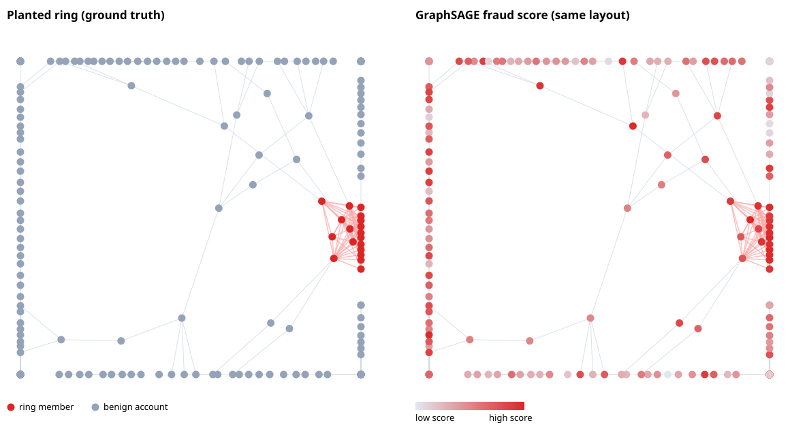

# GNN Fraud Ring Detection

[](https://colab.research.google.com/github/RishabhPande/GNN-fraud-ring-detection/blob/main/examples/quickstart.py)
[](https://doi.org/10.5281/zenodo.23749421)


[](https://github.com/RishabhPande/GNN-fraud-ring-detection/actions/workflows/tests.yml)
[](https://codespaces.new/RishabhPande/GNN-fraud-ring-detection)

**GraphSAGE and GAT from scratch in pure Python. Zero dependencies. Built to catch fraud rings.**

One-hop features miss fraud rings. A ring of mule accounts can look perfectly ordinary one account at a time: normal ages, normal balances, normal transaction sizes. What gives them away is the *wiring*: a dense pocket of accounts transacting with each other far more than chance allows.

This repo generates that pattern synthetically and learns it with graph neural networks implemented end to end: forward pass, backprop through message-passing layers, neighbor sampling, mini-batch SGD. Nothing but the standard library.

> **Disclaimer:** every account in this repo is synthetic. No real people, no real transactions, no real PII anywhere. The generator exists so GNN detectors can be built, tested, and benchmarked without touching sensitive data.

## Seed robustness at a glance

| Seed-robustness sweep | Result |
|---|---|
| GIN + LSTM, AUC/F1, seeds 7-9 | 1.000 |
| PNA, AUC/F1, seeds 7-9 | 1.000 |
| ChebNet / H2GCN, min AUC, seeds 7-9 | 0.944 |
| Mean aggregation, AUC, seed 8 | 0.728 |
| Mean aggregation, AUC, seed 9 | 0.539 |
| SGC, AUC, seed 9 | 0.411 |
| GATv2, AUC, seed 8 | 0.467 |

Test suite: 265 tests. Full per-seed table in Results below.

## Try it in 30 seconds

Click **Open in Colab** above, or run locally:

```bash
python examples/quickstart.py
```

Or as a library:

```python
from gnn_fraud import GraphGenerator, train_sage, train_val_split

g = GraphGenerator(seed=7).generate(n=200, ring_size=18)
train_ids, val_ids = train_val_split(g.labels, seed=7)
model, history = train_sage(g, train_ids, val_ids)
probs = model.predict(g, val_ids)
```

## Results

Seed 7, 200 accounts, 18 ring members. The graph signal is the whole story:

```
model                              thr precision  recall      F1     AUC
GraphSAGE (2-layer, mean agg)      0.28     1.000   0.750   0.857   0.978
GraphSAGE (2-layer, max-pool agg)  0.41     1.000   1.000   1.000   1.000
MLP (features only)                0.23     0.286   0.500   0.364   0.656
```



*Left: the planted ring (red) inside 200 synthetic accounts, seed 7. Right: the same layout with nodes shaded by GraphSAGE fraud-score rank (darkest red = highest score). The layout is force-directed and knows nothing about the labels: the ring clusters on its own because it is wired densely, while benign accounts scatter. That is the whole pitch in one picture: one account at a time the ring looks ordinary, and the wiring gives it away. Regenerate with `python examples/visualize_ring.py` (pure Python, no new dependencies; the script also prints the quickstart validation numbers it is drawn from).*

Same protocol with max-pool aggregation (`examples/pool_example.py`): each
neighbor is transformed through `relu(W_pool @ x_u + b_pool)` and the layer
keeps the elementwise max -- the single loudest tell per dimension, not the
neighborhood mean (the GraphSAGE paper's pooling aggregator, selected with
`aggregator="pool"`).

Same protocol with attention (`examples/gat_example.py`) and on a heterogeneous graph of accounts, devices, and merchants (`examples/hetero_example.py`):

```
GAT (2-layer, attention)            0.29     0.667   1.000   0.800   0.967
Relational GraphSAGE (hetero)       0.31     0.800   1.000   0.889   0.994
```

Same protocol with a GCN (`examples/gcn_example.py`; longer schedule --
100 epochs, patience 25, lr 0.5 -- because the normalized aggregation
shrinks gradients and SAGE's lr 0.1 underfits badly, AUC ~0.48-0.71):

```
GCN (2-layer, normalized)           0.31     0.500   1.000   0.667   0.944
```

GCN lands just under SAGE's mean model: the symmetric normalization
that defines it also dilutes the ring's own signal, since ring members
are the highest-degree nodes in the graph and their messages get
down-weighted the most. Still far above the feature-only baseline -- a
real architectural difference, not a tuning artifact, since both models
train at their own best learning rate.

Same protocol with an SGC (`examples/sgc_example.py`): delete the GCN's
hidden layer and ReLU, propagate the features twice through the
normalized adjacency, then logistic regression:

```
SGC (2-hop propagation)             0.28     0.500   1.000   0.667   0.928
GCN (2-layer, normalized)           0.31     0.500   1.000   0.667   0.944
MLP (features only)                 0.23     0.286   0.500   0.364   0.656
```

SGC lands within 0.016 AUC of the GCN it ablates, with the same F1:
on this graph the hidden layer buys almost nothing, and the propagated
features alone carry the signal. The cheaper, linear, easier-to-audit
model is the one to ship here.

Same protocol with a SIGN (`examples/sign_example.py`): concatenate
the 0-, 1-, and 2-hop propagated features and let a small MLP head
weight the hops, instead of SGC's single linear head over the 2-hop
block alone:

```
SIGN (0/1/2-hop concat + MLP)       0.25     0.500   1.000   0.667   0.956
SGC (2-hop propagation)             0.28     0.500   1.000   0.667   0.928
GCN (2-layer, normalized)           0.31     0.500   1.000   0.667   0.944
MLP (features only)                 0.23     0.286   0.500   0.364   0.656
```

SIGN edges SGC (+0.028 AUC) and the GCN (+0.012) with the same F1:
hop identity buys a little here, and the head's W1 column norms say
why, leaning hardest on the 2-hop block (4.291) over the 1-hop block
(3.839) and the raw features (2.620), so the deeper propagation
carries the ranking and the shallow views add the margin. The gain is
small, and the sweep shows it does not hold up across seeds (AUC
0.956/0.872/0.883, min 0.872), so hop identity buys a little on seed
7 and less elsewhere. Unlike H2GCN the mechanism is cheap: propagation is precomputed once, and
only the head trains.

Same protocol with APPNP (`examples/appnp_example.py`): predict first
with an MLP, then 10 personalized PageRank steps (teleport alpha 0.1)
over the predictions, instead of propagating the features and then
classifying:

```
APPNP (predict, then propagate)     0.19     0.444   1.000   0.615   0.928
SGC (2-hop propagation)             0.28     0.500   1.000   0.667   0.928
MLP (features only)                 0.23     0.286   0.500   0.364   0.656
```

APPNP ties SGC on AUC exactly and trails it slightly on F1: the
teleport does its job (10 propagation steps without washing the node's
own prediction out), but on this graph the order of operations does
not matter much, since both models end up ranking the same dense
pocket. The value is the mechanism, not the headline: where deep
propagation would oversmooth, APPNP is the safe way to run it.

Same protocol with a GPR-GNN (`examples/gpr_example.py`): an MLP
encoder, 10 rounds of normalized propagation of the hidden states,
and a learned weighted sum over the propagation steps -- the GPR-GNN
paper's generalization of APPNP's fixed PageRank coefficients:

```
GPR-GNN (learned gamma)             0.23     0.600   0.750   0.667   0.939
APPNP (predict, then propagate)     0.19     0.444   1.000   0.615   0.928
SGC (2-hop propagation)             0.28     0.500   1.000   0.667   0.928
MLP (features only)                 0.23     0.286   0.500   0.364   0.656
```

GPR-GNN edges APPNP on AUC (0.939 vs 0.928) and F1 (0.667 vs 0.615)
and ties SGC on F1 while edging it on AUC: learning the polynomial
beats fixing it, but only slightly on this graph. The learned gamma
is the interesting part: it peaks at the 1-hop term (0.604 vs the
0.090 init), decays smoothly through the middle steps to 0.021 at
k=9, and keeps a large deep term (0.278 at k=10), with no negative
coefficients -- so no high-pass behavior emerged here, and the gain is
reweighting toward the neighborhood, not a new filter shape. The
coefficients sum to 3.37, up from 1.0 at init: the head absorbs the
scale, so the shape is the finding, not the magnitude. One seed only,
like the other GCN-family headlines.

Same protocol with a GIN (`examples/gin_example.py`):

```
GIN (2-layer, sum agg)              0.50     1.000   1.000   1.000   1.000
GraphSAGE (2-layer, mean agg)       0.28     1.000   0.750   0.857   0.978
```

GIN beats mean-SAGE outright here: sum aggregation keeps the
neighborhood *count* -- a ring member has a dozen ring neighbors,
a background account one or two -- which mean erases and GCN's
normalization dilutes. Learned eps stays near zero at lr 0.1
(layer1 -0.066, layer2 -0.029); lr 0.5 still ranks perfectly but
drives layer-2 eps to -2.19, so 0.1 is the default.

Multi-head GAT (`examples/multihead_gat_example.py`; longer schedule --
150 epochs, patience 40, lr 1.0 -- because the averaged final layer
splits each head's gradient K ways):

```
GAT (1-head)                        0.73     1.000   1.000   1.000   1.000
GAT (2-head)                        0.19     0.800   1.000   0.889   0.994
GAT (4-head)                        0.79     1.000   1.000   1.000   1.000
```

More heads match single-head ranking but buy nothing here: the four
heads learn nearly identical, near-uniform attention (mean pairwise
head L1/2 distance 0.022 on the top-scored ring member), so they
re-learn the same neighborhood mean four times instead of specializing.

With edge timestamps -- the ring's edges land in a 3-day burst at the end of a 30-day timeline -- recency-weighted aggregation (`examples/temporal_example.py`):

```
TemporalGraphSAGE (recency)         0.27     0.571   1.000   0.727   0.950
GraphSAGE (2-layer, mean agg)       0.28     1.000   0.750   0.857   0.978
MLP (features only)                 0.23     0.286   0.500   0.364   0.656
```

Inductive check: train on graph A, freeze the threshold, score a fresh graph B with no retraining. Ranking transfers (AUC 0.84 vs 0.98 transductive); calibration does not, so re-calibrate the threshold per deployment. See `examples/inductive_example.py`.

Edge classification on the same graph: freeze the GraphSAGE encoder, score each *flow* with an MLP head over endpoint-pair features (`examples/edge_example.py`):

```
EdgeHead (frozen SAGE embeddings)       0.48     0.857   1.000   0.923   0.951
```

A second fraud pattern -- money-mule chains (`examples/mule_chain_example.py`): originator -> 4 parallel mule chains -> consolidator -> exit. Thin paths, ~zero triangles, hop timestamps monotone downstream inside a late burst:

```
GraphSAGE (2-layer, mean agg)          0.40     0.800   1.000   0.889   0.978
GraphSAGE (2-layer, max-pool agg)      0.50     0.800   1.000   0.889   0.978
TemporalGraphSAGE (recency)            0.39     0.800   1.000   0.889   0.983
MLP (features only)                    0.60     1.000   0.500   0.667   0.856
```

A third fraud pattern -- smurfing / structuring (`examples/smurfing_example.py`): one source splits a large sum into small sub-threshold amounts routed through 16 smurf intermediaries to a single collector. Fan-out/fan-in, not density and not a path: the source and the sink are hubs, every smurf hangs off exactly those two, no triangles at all, hop pairs fast and late in a burst:

```
GraphSAGE (2-layer, mean agg)          0.30     0.750   0.750   0.750   0.933
TemporalGraphSAGE (recency)            0.57     1.000   0.750   0.857   0.939
MLP (features only)                    0.43     0.400   0.500   0.444   0.672
```

Seed robustness (`examples/seed_robustness_example.py`): the same dense-ring
protocol, fresh graph + split + initialization per seed, AUC/F1 per seed.
Panel 2 runs each model on its own per-model example schedule (100 epochs,
patience 25, lr 0.5 for the full-graph family; 60 epochs, patience 12 for
GATv2 and PNA):

```
model                          seed 7     seed 8     seed 9     mean  min
GraphSAGE (mean agg)           0.978/0.857  0.728/0.333  0.539/0.240  0.748  0.539
GraphSAGE (max-pool agg)       1.000/1.000  1.000/1.000  1.000/1.000  1.000  1.000
GraphSAGE (LSTM agg)           1.000/1.000  1.000/1.000  1.000/1.000  1.000  1.000
GIN (sum agg)                  1.000/1.000  1.000/1.000  1.000/1.000  1.000  1.000
GCN                            0.944/0.667  0.889/0.615  0.889/0.615  0.907  0.889
SGC                            0.928/0.667  0.883/0.571  0.411/0.229  0.741  0.411
APPNP                          0.928/0.615  0.867/0.500  0.894/0.615  0.896  0.867
GATv2                          0.978/0.889  0.467/0.235  0.689/0.364  0.711  0.467
JK-GCN                         0.972/0.800  0.889/0.615  0.911/0.667  0.924  0.889
ChebNet                        1.000/1.000  1.000/1.000  0.944/0.750  0.981  0.944
GCNII-4                        0.944/0.727  0.889/0.615  0.506/0.250  0.780  0.506
TAGCN                          0.961/0.800  0.906/0.615  0.894/0.571  0.920  0.894
PNA                            1.000/1.000  1.000/1.000  1.000/1.000  1.000  1.000
GPR-GNN                        0.939/0.667  0.811/0.375  0.822/0.471  0.857  0.811
MixHop                         0.961/0.800  0.889/0.533  0.867/0.571  0.906  0.867
H2GCN                          0.994/0.889  0.944/0.727  1.000/1.000  0.980  0.944
SIGN                           0.956/0.667  0.872/0.545  0.883/0.500  0.904  0.872
```

Mean is fragile, but no longer the only fragile one: SGC and GCNII-4
collapse on seed 9 (0.411, 0.506), GATv2 collapses on seed 8 (0.467),
and GCN, APPNP, TAGCN, SIGN, GPR-GNN, and MixHop all sit just under
the 0.90 bar on seeds 8-9. What holds across all three seeds is
specific: PNA at 1.000 everywhere, ChebNet and H2GCN never below
0.944, JK-GCN at 0.889-0.972, alongside the panel-1 survivors
max-pool, LSTM, and GIN. The survivors all keep a channel the
normalized neighborhood mix cannot wash out (count-aware towers,
an ego block, per-term weights, a layer-1 concatenation); the models
that only ever see a normalized mix inherit mean's fragility. Three
seeds is still a small sweep, so this is an observation about a
pattern, not a ranking.

Same protocol with a ChebNet (`examples/cheb_example.py`; longer schedule --
100 epochs, patience 25, lr 0.5, the GCN family's schedule):

```
ChebNet (2-layer, K=2)              0.50     1.000   1.000   1.000   1.000
GraphSAGE (2-layer, mean agg)       0.28     1.000   0.750   0.857   0.978
```

ChebNet matches the repo's best models on the dense ring and beats the
plain GCN (AUC 0.944) it is closest to: each layer mixes the 0-, 1-, and
2-hop Chebyshev terms with learned weights instead of one normalized hop,
so the ring's dense pocket survives without the hub down-weighting that
costs the GCN. One seed only, like the other GCN-family headlines.

Same protocol with a GCNII (`examples/gcnii_example.py`; input GCN layer
+ 4 GCNII layers, alpha 0.2, same 100-epoch schedule):

```
GCNII (input + 4 layers)           0.14     0.571   1.000   0.727   0.944
GCNII deep (input + 8 layers)      0.16     0.571   1.000   0.727   0.950
GCN (2-layer)                      0.31     0.500   1.000   0.667   0.944
GraphSAGE (2-layer, mean agg)      0.28     1.000   0.750   0.857   0.978
```

GCNII ties the plain GCN on AUC (0.944 both) and edges it on F1 (0.727
vs 0.667), while still trailing SAGE mean (0.978). The residual's real
payoff is depth: the 8-layer stack reaches 0.950 AUC instead of
collapsing the way a plain deep GCN oversmooths, because every layer
mixes back the input layer's representation and the identity-shrunk
weights keep the gradient alive. Alpha matters: the paper's 0.1 lands
just under 0.90 AUC here (0.894), 0.2 reaches 0.944. One seed only, like
the other GCN-family headlines.

Same protocol with a TAGCN (`examples/tag_example.py`; two layers,
K = 2 per layer, so up to 4 hops with a separate weight matrix per
hop, same 100-epoch schedule):

```
TAGCN (2-layer, K=2)                0.21     0.667   1.000   0.800   0.961
GCN (2-layer)                       0.31     0.500   1.000   0.667   0.944
GraphSAGE (2-layer, mean agg)       0.28     1.000   0.750   0.857   0.978
```

TAGCN beats the GCN it generalizes (AUC 0.961 vs 0.944, F1 0.800 vs
0.667) while still trailing SAGE mean (0.978/0.857): letting one layer
mix the 0-, 1-, and 2-hop neighborhoods with per-hop weights recovers
some of what the GCN's single hop per layer loses, but the symmetric
normalization shared by both still down-weights the ring hubs. One
seed only, like the other GCN-family headlines.

Same protocol with a PNA (`examples/pna_example.py`; two layers,
four aggregators -- mean, max, min, std -- each under three degree
scalers, delta = mean degree 2.19, same 60-epoch schedule as GIN):

```
PNA (2-layer, 4 aggs x 3 scalers)  0.50     1.000   1.000   1.000   1.000
GraphSAGE (2-layer, mean agg)      0.28     1.000   0.750   0.857   0.978
```

PNA matches the repo's best models on the seed-7 dense ring (AUC
1.000, F1 1.000 vs SAGE mean's 0.978/0.857), joining max-pool, LSTM,
and GIN at the top -- and for the same reason GIN wins: the extra
towers let the model see *how many* suspicious neighbors an account
has (max and std over a dozen ring neighbors look nothing like over
one or two background neighbors), where the flat mean washes that
out. The seed sweep retires the one-seed caveat for PNA: it holds
AUC 1.000 / F1 1.000 on all three seeds, so this is a robustness
claim as well as a mechanism result.

Same protocol with an H2GCN (`examples/h2gcn_example.py`; two layers,
ego and neighborhood kept in separate blocks, 1- and 2-hop aggregates,
all-layer concatenation into the head, same 100-epoch schedule):

```
H2GCN (ego + 1/2-hop, concat)   0.50     0.800   1.000   0.889   0.994
GCN (2-layer, normalized)       0.31     0.500   1.000   0.667   0.944
GraphSAGE (2-layer, mean agg)   0.39     1.000   0.750   0.857   0.989
MLP (features only)             0.23     0.286   0.500   0.364   0.656
```

H2GCN beats the plain GCN by a wide margin (AUC 0.994 vs 0.944, F1
0.889 vs 0.667) and edges SAGE mean on the same schedule (0.994 vs
0.989, F1 0.889 vs 0.857), landing just under the repo's best models
(1.000). The separation is doing real work here, unlike MixHop's
concatenation: keeping the ego embedding out of the neighborhood
average means the ring's hubs are not down-weighted the way the
GCN's symmetric normalization down-weights them, and the head
actually uses the separate views -- its weight norms lean hardest
on the 1-hop block (2.179), then the 2-hop block (1.605), then the
embedding view (0.950), so the graph views dominate the decision
rather than the node's own features. The seed sweep retires the
one-seed caveat for H2GCN (AUC 0.994/0.944/1.000, min 0.944), and
the same open question as ChebNet
and TAGCN: a 4-hop receptive field is untested on the thin mule
chains, where it could oversmooth.

## What's inside

* **Generate** (`generator.py`): N account nodes, six normalized features. Benign accounts wire sparsely at random; a planted ring forms a dense subgraph with near-camouflaged features. Weak tells individually, damning once pooled. A second pattern, `generate_mule_chain()`, plants a laundering network instead: originator -> parallel mule chains -> consolidator -> exit -- thin paths, ~zero triangles, hop timestamps monotone downstream in a late burst -- with per-role feature tells (pass-through mules, orchestration-volume organizer, emptied exit). A third pattern, `generate_smurfing()`, plants a structuring network: one source -> N smurf intermediaries -> one collector -- fan-out/fan-in hubs and spokes, zero triangles, in-flow-before-out-flow hop pairs inside a late burst -- with per-role tells (small-amount pass-through smurfs, fan-out source, emptied collector).
* **Message-pass** (`sage.py`): two GraphSAGE layers with mean, max-pool, or LSTM aggregation, sigmoid output, positive-class-weighted BCE (fraud data is imbalanced; without it the model collapses to the base rate). Neighbor-sampled mini-batches keep training O(batch*k^2). The max-pool aggregator (the GraphSAGE paper's pooling aggregator) transforms each neighbor through `relu(W_pool @ x_u + b_pool)` -- He-initialized, since it feeds a ReLU -- then takes the elementwise max; backprop routes each dimension's gradient to its argmax neighbor. The LSTM aggregator (the paper's third aggregator) feeds neighbors through an LSTM in a pseudo-random order -- seeded from the neighbor vectors themselves, so the same neighborhood always takes the same order -- and takes the final hidden state as the aggregation, with full backprop through time (numeric-gradient-checked over all input, recurrent, and bias parameters) and a forget-gate bias initialized to 1.0. Mean-mode training is bit-for-bit unchanged (verified against the pre-pool code: identical loss trajectories and AUC).
* **Convolve** (`gcn.py`): two-layer GCN (Kipf & Welling) with symmetric degree normalization (`D_hat^{-1/2} A_hat D_hat^{-1/2}`, self-loops included), full-graph forward -- no sampling, since the normalization needs true degrees -- and full backprop through both layers (numeric-gradient-checked, layer and end-to-end). Needs a larger step than SAGE (lr 0.5 vs 0.1): the normalized aggregation shrinks gradients. Lands just under SAGE's mean model on the dense ring (AUC 0.944 vs 0.978) because ring members are the graph's hubs and normalization down-weights their messages most.
* **Spectral** (`cheb.py`): ChebNet (Defferrard et al.) -- one layer mixes
the 0-, 1-, and 2-hop Chebyshev polynomials of the rescaled normalized
Laplacian (`L_tilde = -D^{-1/2} A D^{-1/2}` under the `lambda_max ~= 2`
approximation) with a learned weight matrix per term, so a single layer
reads a 2-hop neighborhood; `K = 0` degrades exactly to a linear layer
over raw features. Full backprop runs the polynomial recurrence
backwards (numeric-gradient-checked at the layer and end to end).
* **Jump** (`jk.py`): Jumping Knowledge GCN (Xu et al.) -- two GCN layers whose layer-1 and layer-2 embeddings are concatenated and scored together (`[h1_v || h2_v]`), so the head reads the 1-hop pocket and the 2-hop neighborhood at once instead of only the last layer. Backprop splits at the concatenation: layer 1 gets its direct head gradient plus the gradient flowing back through layer 2 (numeric-gradient-checked end to end, including that split). Beats the plain GCN on the seed-7 dense ring (AUC 0.972 vs 0.944, F1 0.800 vs 0.667).
* **Adapt** (`tag.py`): TAGCN (Du et al.) -- one layer mixes the 0-, 1-, and 2-hop powers of the normalized adjacency, each with its own weight matrix, instead of one normalized hop per layer; backprop reverses each power through the same symmetric matrix (numeric-gradient-checked at the layer and end to end). Beats the plain GCN on the seed-7 dense ring (AUC 0.961 vs 0.944, F1 0.800 vs 0.667) while still trailing SAGE mean.
* **Concatenate hops** (`mixhop.py`): MixHop (Abu-El-Haija et al.) -- one layer mixes the 0-, 1-, and 2-hop powers of the row-normalized adjacency like TAGCN, but concatenates the per-hop transforms instead of summing them, so the head reads the pocket and the node's own features as separate columns; backprop runs each power backwards through the explicit transpose, since the row normalization is not symmetric (numeric-gradient-checked at the layer and end to end, including the input gradient). Ties TAGCN exactly on the seed-7 dense ring (AUC 0.961, F1 0.800).
* **Separate ego from neighbors** (`h2gcn.py`): H2GCN (Zhu et al.) -- built for graphs where neighbors are *not* like the node itself. Each layer keeps the ego embedding, the 1-hop aggregate, and the 2-hop aggregate in separate blocks of one concatenated input (`relu([H || A H || A^2 H] W + b)`, row-normalized adjacency without self-loops), and the head scores the concatenation of every layer's output, so the raw-feature view, the 1-hop view, and the 2-hop view stay separate all the way to the decision. Full backprop through the blocks, the powers (explicit transpose, since the normalization is not symmetric), and the embedding layer (numeric-gradient-checked at the layer and end to end, including the embedding weights). Beats the plain GCN on the seed-7 dense ring (AUC 0.994 vs 0.944, F1 0.889 vs 0.667) and edges SAGE mean on the same schedule; `layer_block_norms()` reports how much the head leans on each layer's block.
* **Simplify** (`sgc.py`): Simplified Graph Convolution (Wu et al.) -- K-hop symmetric-normalized propagation (`propagate_features`, `hops=0` degrades exactly to logistic regression on raw features), then a single linear head trained with weighted BCE. The GCN ablation: no hidden layer, no nonlinearity between propagations, full backprop replaced by logistic-regression gradients (numeric-gradient-checked).
* **Propagate predictions** (`appnp.py`): APPNP (Klicpera et al.) -- the opposite order from SGC: an MLP predicts a fraud logit per node from features alone, then personalized PageRank propagation (`propagate_predictions`, teleport `alpha=0.1`, `steps=10` by default) smooths the predictions over the graph, so deep propagation sharpens the neighborhood consensus without erasing the node's own prediction. Full backprop through the propagation steps and the MLP (numeric-gradient-checked).
* **Learn the propagation weights** (`gpr.py`): GPR-GNN (Chien et al.) -- an MLP encoder, K rounds of normalized propagation of the *hidden states* (not the logits), then a learned weighted sum over the propagation steps (`ppr_gamma_init` starts the coefficients at the APPNP PageRank weights), then a linear head. Full backprop through the weighted sum (the gamma gradient), the propagation chain, and the MLP (numeric-gradient-checked, including gamma). The APPNP generalization: fixed teleport coefficients become learned polynomial weights, which may go negative -- a high-pass filter -- where the data wants it.
* **Isomorph** (`gin.py`): two-layer GIN (Xu et al.) -- sum aggregation, a learnable `eps` weighting the node's own features, then a two-linear-layer MLP per layer (the paper's injectivity recipe: sum + MLP distinguishes neighbor multisets where mean and normalized sums cannot). Full-graph forward, full backprop (numeric-gradient-checked, layer and end-to-end, including `eps`). Beats mean-SAGE on the dense ring (AUC 1.000 vs 0.978, F1 1.000 vs 0.857) because the ring's signal is partly a count, and sum is the only aggregation here that keeps it.
* **Attend** (`gat.py`): two-layer multi-head GAT, full backprop through attention (numeric-gradient-checked per head). Layer 1 concatenates head outputs, layer 2 averages them (the GAT paper's convention); `n_heads=1` reproduces the classic single-head model bit-for-bit, and legacy single-head checkpoints still load. `attention_weights(v)` shows which counterparties drove an account's score (head-averaged); `attention_weights_per_head(v)` shows each head separately.
* **Attend, dynamically** (`gatv2.py`): two-layer multi-head GATv2 (Brody et al.) -- the score is `a . LeakyReLU(W_att @ [h_v || h_u])`, so the neighbor ranking can depend on the query node, where GAT's ranking cannot (its self term is constant across neighbors). Full backprop through the pair map (numeric-gradient-checked in concat and average modes, including a hand-computed ranking flip GAT cannot express). Same head-combination convention and introspection API as GAT.
* **Relate** (`rsage.py`, `hetero.py`): R-GCN-lite over a heterogeneous graph. Accounts, devices, merchants as distinct node types; each relation gets its own message matrix, because a shared *device* means something different from a shared *counterparty*.
* **Time** (`temporal.py`): edges carry timestamps; ring edges land in a fast late burst while benign edges spread over the timeline. Each layer weights neighbors by recency (`softmax(-Δt/τ)`) with a learned, log-parametrized decay timescale, so aggregation concentrates on burst-coordinated neighbors.
* **Generalize** (`inductive.py`): inductive evaluation on unseen nodes. The honest protocol: frozen threshold from the training graph, no label leakage.
* **Classify edges** (`edge_cls.py`): score individual flows, not just accounts. An MLP head over `[h_u, h_v, h_u⊙h_v, |h_u−h_v|]` on *frozen* encoder embeddings, trained on edge-level mini-batches with full backprop through the head (numeric-gradient-checked). A ring-internal edge is one whose endpoints are both ring members.
* **Baseline** (`baseline.py`): feature-only MLP under the same protocol, so the graph signal is measured, not assumed.
* **Score** (`evaluate.py`): precision/recall/F1 with F1-tuned operating threshold plus ROC-AUC, all from scratch.

## Honest findings

* The GAT matches GraphSAGE, but its learned attention stays near-uniform on camouflaged rings: the signal lives in the neighborhood *mean*, not any single neighbor. Attention earns its keep where neighbors differ, which is what the heterogeneous graph provides.
* Multi-head attention does not rescue this: on camouflaged rings the heads do not specialize -- four heads learn the same diffuse distribution (pairwise L1/2 distance 0.022) -- so 4-head AUC ties single-head (1.000 vs 1.000) while training far slower. The averaged final layer dilutes each head's gradient K-fold, so under vanilla SGD the heads sit in a flat uniform-attention region for dozens of epochs; short-patience early stopping can then lock in a degenerate checkpoint that looks fine on validation BCE (0.35) but ranks backwards (AUC 0.256). Budget a long schedule (150 epochs, patience 40 here) and verify ranking, not just loss. Heads would earn their keep where different neighbor *kinds* matter -- e.g. one head for the dense pocket, another for feature outliers -- which the current generator does not provide.
* The hetero gap is wide because the generator plants a loud device-sharing pattern. Real rings launder through shared devices more subtly. The point is the mechanism, not the magnitude: per-relation weights learn *which kind* of neighbor carries the signal.
* Inductive ranking transfers across fresh graphs (AUC 0.84); score calibration does not (frozen-threshold F1 collapses 0.86 to 0.08). Ship the aggregation weights freely, re-calibrate the threshold per deployment.
* Edge classification is an easier task than node classification here, not a harder one: the head is a probe of frozen embeddings, so it mostly re-discovers the dense pocket (AUC 0.951 on held-out edges). The genuinely hard negatives are the bridge edges -- ring member to benign account -- which score halfway between (0.479 vs 0.511 ring-internal, 0.421 benign): one suspicious endpoint leaks signal. A production edge model would add flow features (amount, direction, timing) rather than leaning on structure alone.
* Recency weighting is not free: it concentrates aggregation on recent edges, which sharpens the burst but thins each node's effective neighborhood and adds variance. On this generator the dense structure is already a near-perfect signal, so the plain mean wins slightly (AUC 0.978 vs 0.950) while both crush the feature baseline (0.656). Recency earns its keep where old edges mislead -- dormant accounts, or histories that predate a compromise -- which is the next experiment, not this one. The learned timescale barely moves from its 5-day init: the loss is nearly flat in τ once the burst/background separation is strong, and its gradient (numeric-checked) is orders of magnitude smaller than the weight gradients.
* Money-mule chains rank about as well as dense pockets (AUC 0.98 both), but the graph signal's marginal value is smaller: the MLP climbs to 0.856 from 0.656 because the organizer/consolidator/exit roles carry stronger individual tells than camouflaged ring members. A production story about "structure over features" should pick its pattern honestly -- dense pockets are where the GNN earns the biggest premium. Thin chains also need patience: the default 30-epoch schedule only reached AUC 0.78, while 120 epochs reached 0.98. Recency weighting adds nothing on the chains (0.983 vs 0.978): on an undirected graph the sequential burst is already separated by structure alone.
* Max-pool aggregation matches or beats mean on both patterns (dense ring: AUC 1.000 vs 0.978, F1 1.000 vs 0.857; chains: tied at 0.978/0.889) -- the learned per-neighbor transform amplifies the tell direction before the max, so one strongly-suspicious neighbor suffices where mean needs the whole neighborhood to agree. It is also the stabler optimizer on the dense ring: across generator seeds 7-9 the mean model twice collapses to a degenerate checkpoint (validation BCE looks healthy, ranking broken: AUC 0.73 and 0.54 -- the same failure mode the multi-head GAT showed), while max-pool holds AUC 1.000 on all three seeds. The seed fragility is pre-existing, not introduced here: mean-mode training is bit-for-bit identical to the pre-pool code (verified: identical loss trajectories and AUC on both seeds). Two implementation details mattered: the pool transform needs its own bias (the paper has one; without it the transform starts half-dead) and He -- not Xavier -- initialization, since it feeds a ReLU.
* LSTM aggregation beats mean on the seed-7 dense ring (AUC 1.000 vs 0.978, F1 1.000 vs 0.857) -- the recurrence lets the summary weigh neighbors by position in the feed order instead of flat-averaging them, and every neighbor gets gradient (unlike max-pool's argmax routing). One seed only, so this is a mechanism result, not a robustness claim: unlike max-pool it has not been run across seeds 7-9, and the LSTM trains noticeably slower in pure Python (a per-neighbor cell vs a single transform), so it is the expensive way to buy the same headline number on this generator.
* GIN beats mean-SAGE on the seed-7 dense ring (AUC 1.000 vs 0.978, F1 1.000 vs 0.857) for the simplest reason in the repo: the ring's tell is partly how *many* suspicious neighbors an account has, and sum is the only aggregation here that preserves count. The seed sweep retires the one-seed caveat for GIN as well (AUC 1.000 / F1 1.000 on all three seeds), and one tuning note: lr 0.5 still ranks perfectly but drives layer-2 eps to -2.19, i.e. the model starts down-weighting its own features to compensate for the sum's scale, so the default stays 0.1 where eps stays near zero (-0.066, -0.029).
* Smurfing ranks about as well as the dense pocket and the chains (AUC 0.933 vs 0.978 both), but the graph premium is back to ring levels, not chain levels: the MLP stalls at 0.672 (vs 0.856 on chains) because the hubs' degree tell -- a source touching 16 smurfs, a sink collecting from 16 -- is invisible to a feature-only model, which sees only the smurfs' weak per-account tells (small amounts, pass-through balances). Density is the wrong lens for this pattern (0.209, between the ring's ~0.7 and the chains' thin paths): what identifies it is the hub/spoke degree split plus zero triangles. Recency adds almost nothing on top of mean (0.939 vs 0.933): the fan structure already separates the burst from background wiring, so timing is corroboration, not the signal. Like the chains, smurfing needs the long schedule -- the 30-epoch schedule only reaches AUC 0.850.
* SGC nearly matches the GCN it ablates (AUC 0.928 vs 0.944, same F1 0.667) on the seed-7 dense ring, so on this graph the GCN's hidden layer buys almost nothing: the signal is in the propagated features, not in a learned nonlinear transform of them. The sweep shows the seed-7 match is fragile: SGC holds 0.928/0.883 on seeds 7-8, then collapses to 0.411 on seed 9, so it is a shipping argument for this generator on a good seed, not a general claim that SGC matches GCN. Where SGC does match, it is strictly cheaper to train, audit, and explain, since the whole model is one weight vector over propagated features.
* APPNP ties SGC on AUC exactly (0.928 both) with a slightly lower F1 (0.615 vs 0.667) on the seed-7 dense ring, so the order of operations, predict-then-propagate versus propagate-then-classify, matters little here: both end up ranking the same dense pocket, and the teleport holds up over 10 steps where plain propagation would oversmooth. The sweep leaves APPNP just under the 0.90 bar on seeds 8-9 (AUC 0.867/0.894), and the same conclusion holds in reverse: APPNP's value is as the safe deep-propagation mechanism for graphs where plain propagation would wash nodes out, not as a headline improvement on this generator.
* GPR-GNN edges APPNP on the seed-7 dense ring (AUC 0.939 vs 0.928, F1 0.667 vs 0.615) and ties SGC on F1 while edging it on AUC (0.939 vs 0.928): learning the propagation polynomial beats fixing it, but only slightly on this graph, where the fixed PPR weights were already close. The learned gamma is the interesting part: it peaks at the 1-hop term (0.604 vs the 0.090 init), decays smoothly through the middle steps to 0.021 at k=9, and keeps a large deep term (0.278 at k=10), with no negative coefficients -- so no high-pass filter emerged here, and the gain is reweighting toward the neighborhood, not a new filter shape. The coefficients sum to 3.37, up from 1.0 at init: the head absorbs the scale, so the shape is the finding, not the magnitude. The sweep puts GPR-GNN at 0.811-0.822 on seeds 8-9, below the bar it clears on seed 7.
* MixHop ties TAGCN exactly on the seed-7 dense ring (AUC 0.961, F1 0.800) and beats the plain GCN (0.944/0.667) while still trailing SAGE mean (0.978/0.857): concatenating the per-hop transforms instead of summing them changes nothing here, even though the head can now weight the 0-, 1-, and 2-hop blocks separately and the row normalization stops down-weighting the ring hubs. So hop identity is not the bottleneck on this graph, and MixHop joins GATv2 as a mechanism the generator does not reward: the ring signal is neighborhood-wide, and no per-hop split beats the mean at finding it. The sweep puts MixHop at 0.889/0.867 on seeds 8-9, just under the bar.
* H2GCN beats the plain GCN by a wide margin on the seed-7 dense ring (AUC 0.994 vs 0.944, F1 0.889 vs 0.667) and edges SAGE mean on the same 100-epoch schedule (0.994 vs 0.989, F1 0.889 vs 0.857): unlike MixHop's concatenation, the ego/neighbor separation is doing real work here, because keeping the ego embedding out of the neighborhood average stops the normalization from down-weighting the ring hubs, and the head's weight norms confirm the graph views carry the decision (1-hop block 2.179, 2-hop block 1.605, embedding view 0.950). The sweep retires the one-seed caveat for H2GCN: it holds AUC 0.944-1.000 across seeds 7-9.
* Seed robustness closes the GIN/LSTM one-seed caveat and extends the sweep to the thirteen later models, and the mean-fragility story gets sharper, not softer: across seeds 7-9, max-pool, LSTM, GIN, and PNA all hold AUC 1.000 / F1 1.000 on every seed, ChebNet and H2GCN never drop below AUC 0.944, and JK-GCN stays at 0.889-0.972, while mean collapses on two of three (AUC 0.728 on seed 8, 0.539 on seed 9 -- worse than the feature baseline's 0.656 on seed 7, and a genuinely backwards ranking, not noise) and SGC (0.411) and GCNII-4 (0.506) collapse with it on seed 9, GATv2 collapses on seed 8 (0.467), and GCN, APPNP, TAGCN, SIGN, GPR-GNN, and MixHop all sit just under the 0.90 bar on seeds 8-9. So the fragility is specific to models that only ever see a normalized mix of their neighbors, not to the training protocol: every model here trains on its own example schedule, and only the ones that keep a channel the mix cannot wash out hold up. Three seeds is still a small sweep -- the claim is "holds where mean demonstrably breaks", not "holds everywhere".
* GATv2 edges out GAT on the seed-7 dense ring (AUC 0.978 vs 0.967, F1 0.889 vs 0.800) but not for the reason its name suggests: its trained layer-2 attention is perfectly diffuse (entropy gap 0.000 nats, every counterparty at 0.084), exactly like GAT's. The small gain comes from the different parameterization, not from selective listening, so dynamic attention joins static attention as a mechanism this generator does not reward: the ring signal is neighborhood-wide, and no ranking over neighbors can beat the mean at finding it. The sweep is unkind to GATv2: it collapses to 0.467 on seed 8 and 0.689 on seed 9, so the seed-7 edge over GAT does not generalize.
* JK-GCN beats the plain GCN on the seed-7 dense ring (AUC 0.972 vs 0.944, F1 0.800 vs 0.667) but still trails SAGE mean (0.978/0.857) and max-pool (1.000/1.000): keeping the shallow representation helps, so the second aggregation was washing some pocket signal out, but the remaining gap is the normalization itself, not the lost layer. The extra head width (32 weights instead of 16) buys a real but modest gain, and the sweep leaves JK-GCN just under the bar on seed 8 (0.889) but clearing it on seeds 7 and 9 (0.972/0.911).
* ChebNet matches the repo's best models on the seed-7 dense ring (AUC 1.000, F1 1.000) and beats the plain GCN (0.944/0.667) it is closest to: the per-term weights let one layer keep the 0-hop term (a node's own features, no self-loop normalization) alongside the 1- and 2-hop terms, so the ring's hubs are not down-weighted the way the GCN's symmetric normalization down-weights them. The sweep retires the one-seed caveat for ChebNet (AUC 1.000/1.000/0.944, min 0.944), and the wider receptive field (2 hops per layer, 4 across the two-layer model) is untested on sparser patterns like the mule chains, where it could oversmooth.
* TAGCN beats the plain GCN on the seed-7 dense ring (AUC 0.961 vs 0.944, F1 0.800 vs 0.667) but still trails SAGE mean (0.978/0.857): per-hop weights recover some of what a single hop per layer loses, yet the shared symmetric normalization still down-weights the ring hubs that carry the signal, so the gap to SAGE is the normalization itself, not the hop count. The sweep leaves TAGCN just under the bar on seeds 8-9 (0.906/0.894), and the same open question as ChebNet: a 4-hop receptive field is untested on the thin mule chains, where it could oversmooth.
* PNA matches the repo's best models on the seed-7 dense ring (AUC 1.000, F1 1.000) and beats SAGE mean (0.978/0.857): reading each neighborhood four ways (mean, max, min, std) under three degree scalers lets the model see neighborhood count and spread where the flat mean cannot, the same reason GIN's sum wins. The seed sweep retires the one-seed caveat for PNA: it holds AUC 1.000 / F1 1.000 on all three seeds, so this is a robustness claim as well as a mechanism result.

## Roadmap

* [x] Two-layer GraphSAGE with mean aggregation, from scratch
* [x] Neighbor-sampled mini-batch training + early stopping
* [x] Feature-only MLP baseline showing the graph signal matters
* [x] GAT attention layer
* [x] Heterogeneous graphs (accounts, devices, merchants)
* [x] Inductive evaluation on unseen nodes
* [x] Temporal edges: rings form fast -- edge timestamps with recency-weighted aggregation and a learned decay timescale
* [x] Edge classification: score flows (ring-internal vs background edges) with an MLP head over frozen GNN embeddings
* [x] Multi-head GAT: independent attention heads (concat in layer 1, average in layer 2 per the GAT paper), per-head backprop with numeric gradient checks, per-head attention introspection, legacy checkpoint compatibility
* [x] Money-mule chains: a second fraud pattern -- originator -> parallel mule chains -> consolidator -> exit (thin paths, ~zero triangles, monotone burst hop timestamps), per-role feature tells, and a head-to-head with the dense pocket showing where the graph signal's premium actually lives
* [x] Max-pool aggregator: the GraphSAGE paper's pooling aggregator (`aggregator="pool"` on `SAGELayer`/`GraphSAGE`/`train_sage`) -- per-neighbor `relu(W_pool @ x + b_pool)` transform with He init, elementwise max, argmax-routed backprop (numeric-gradient-checked); head-to-head vs mean on both patterns plus a seed-robustness check showing it avoids the mean model's degenerate checkpoints
* [x] LSTM aggregator: the GraphSAGE paper's third aggregator (`aggregator="lstm"` on `SAGELayer`/`GraphSAGE`/`train_sage`) -- neighbors in pseudo-random order (seeded from the neighbor vectors, so training and inference are reproducible) through a from-scratch LSTM cell, final hidden state as the aggregation, full BPTT (numeric-gradient-checked over every gate parameter), forget-bias 1.0 init, legacy checkpoint compatibility; on the seed-7 dense ring it beats mean (AUC 1.000 vs 0.978, F1 1.000 vs 0.857)
* [x] GCN: two-layer Graph Convolutional Network (Kipf & Welling, `gcn.py`/`train_gcn`) -- symmetric degree normalization (`D_hat^{-1/2} A_hat D_hat^{-1/2}` with self-loops), full-graph forward (no sampling: the normalization needs true degrees), full backprop (numeric-gradient-checked at the layer and end-to-end); needs lr 0.5 (SAGE's 0.1 underfits, AUC ~0.48-0.71); on the seed-7 dense ring it lands just under SAGE mean (AUC 0.944 vs 0.978, F1 0.667 vs 0.857) because ring members are the graph's hubs and normalization down-weights their messages most
* [x] GIN: two-layer Graph Isomorphism Network (Xu et al., `gin.py`/`train_gin`) -- sum aggregation, learnable `eps`, two-linear-layer MLP per layer, full-graph forward, full backprop (numeric-gradient-checked at the layer and end-to-end, including `eps`); on the seed-7 dense ring it beats SAGE mean (AUC 1.000 vs 0.978, F1 1.000 vs 0.857) because sum preserves the neighborhood count the ring's signal partly is; lr 0.1 (0.5 ranks the same but drives layer-2 eps to -2.19)
* [x] Smurfing / structuring: a third fraud pattern (`generate_smurfing()`) -- one source -> N smurf intermediaries -> one collector, fan-out/fan-in hubs and spokes with zero triangles, in-flow-before-out-flow hop pairs inside a late burst, per-role feature tells (small-amount pass-through smurfs, fan-out source, emptied collector); on the seed-7 graph SAGE mean reaches AUC 0.933 vs the MLP's 0.672, with recency adding almost nothing (0.939) -- the degree tell, invisible to features alone, is the signal
* [x] Seed-robustness sweep (`examples/seed_robustness_example.py`): the dense-ring protocol rerun on fresh graphs for seeds 7-9 (graph, split, and init all re-seeded) -- max-pool, LSTM, and GIN hold AUC 1.000 / F1 1.000 on all three seeds while mean collapses on seeds 8-9 (AUC 0.728, 0.539), retiring the GIN/LSTM one-seed caveats and showing the mean fragility is aggregator-specific, not protocol-wide. Extended to the thirteen later models (GCN, SGC, APPNP, GATv2, JK-GCN, ChebNet, GCNII, TAGCN, PNA, GPR-GNN, MixHop, H2GCN, SIGN), each on its example schedule: PNA holds 1.000 on all three seeds and ChebNet/H2GCN never drop below 0.944, while SGC (0.411) and GCNII-4 (0.506) collapse on seed 9, GATv2 collapses on seed 8 (0.467), and the rest sit just under the 0.90 bar on seeds 8-9 -- so the fragility belongs to models that only ever see a normalized mix of their neighbors, not to one aggregator
* [x] SGC: Simplified Graph Convolution (Wu et al., `sgc.py`/`train_sgc`) -- K-hop symmetric-normalized propagation then logistic regression, the GCN with its hidden layer and nonlinearity removed; on the seed-7 dense ring it lands within 0.016 AUC of the GCN (0.928 vs 0.944, same F1 0.667), showing the ring's signal lives in the propagated features themselves
* [x] APPNP: Approximate Personalized Propagation of Neural Predictions (Klicpera et al., `appnp.py`/`train_appnp`) -- predict first with an MLP, then 10 personalized PageRank steps (teleport alpha 0.1) over the predictions, the opposite order from SGC; full backprop through propagation and the MLP (numeric-gradient-checked); on the seed-7 dense ring it ties SGC on AUC exactly (0.928 both, F1 0.615 vs 0.667), showing the teleport holds up over deep propagation where plain propagation would oversmooth
* [x] GATv2: dynamic attention (Brody et al., `gatv2.py`/`train_gatv2`) -- score from `a . LeakyReLU(W_att @ [h_v || h_u])` so neighbor ranking can depend on the query node, full backprop numeric-gradient-checked in concat and average modes, hand-computed ranking flip that GAT cannot express; on the seed-7 dense ring it edges out GAT (AUC 0.978 vs 0.967, F1 0.889 vs 0.800) while its trained attention stays perfectly diffuse (entropy gap 0.000), so the gain is parameterization, not selective listening
* [x] Demo visualization (`examples/visualize_ring.py` -> `docs/ring-detection.svg`, embedded above): two-panel figure from the quickstart protocol -- planted ring vs GraphSAGE fraud-score rank on the same force-directed layout (pure Python, no new dependencies). It replaces the earlier `plot_ring.py` figure, whose layout placed ring members on a circle by hand and needed numpy and matplotlib. Rank shading, not a raw 0-to-1 scale: the model's raw scores sit in a narrow band (strong ranking, weak calibration), so raw shading would render every node the same pale gray.
* [x] Jumping Knowledge GCN (Xu et al., `jk.py`/`train_jk`)
* [x] ChebNet: Chebyshev spectral convolution (Defferrard et al., `cheb.py`/`train_cheb`) -- two layers with `K = 2` per layer, rescaled normalized Laplacian under the `lambda_max ~= 2` approximation, full backprop through the polynomial recurrence (numeric-gradient-checked at the layer and end to end); on the seed-7 dense ring it matches the repo's best models (AUC 1.000, F1 1.000) and beats the plain GCN (AUC 0.944), since the learned per-term weights keep each node's own features without the GCN's hub down-weighting -- two GCN layers with a `[layer-1 || layer-2]` output head, full backprop with the split gradient into layer 1 (numeric-gradient-checked end to end); on the seed-7 dense ring it beats the plain GCN (AUC 0.972 vs 0.944, F1 0.800 vs 0.667) while still trailing SAGE mean and max-pool, showing the second aggregation was washing out some pocket signal but normalization is the remaining gap
* [x] GCNII: deep GCN with initial residual connections and identity mapping (Chen et al., `gcnii.py`/`train_gcnii`) -- input GCN layer plus GCNII layers with `beta_l = log(lam / l + 1)`, full backprop through the stack including the residual branches (numeric-gradient-checked at the layer and end to end); on the seed-7 dense ring the 4-layer model ties the plain GCN on AUC (0.944 both, F1 0.727 vs 0.667) and the 8-layer stack still reaches AUC 0.950, showing depth without oversmoothing collapse; alpha defaults to 0.2, since the paper's 0.1 lands at 0.894 here
* [x] TAGCN: topology-adaptive graph convolution (Du et al., `tag.py`/`train_tag`) -- two layers with `K = 2` per layer, each layer mixing the 0-, 1-, and 2-hop powers of the normalized adjacency with a learned weight matrix per hop, full backprop through the powers (numeric-gradient-checked at the layer and end to end); on the seed-7 dense ring it beats the plain GCN (AUC 0.961 vs 0.944, F1 0.800 vs 0.667) while still trailing SAGE mean (0.978/0.857), showing per-hop weights help but the shared normalization still costs against the hubs
* [x] PNA: Principal Neighbourhood Aggregation (Corso et al., `pna.py`/`train_pna`) -- two layers, each reading the neighborhood four ways (mean, max, min, population std) under three degree scalers (identity, amplification, attenuation, delta = mean degree), concatenated with the node's own embedding through one linear layer + ReLU; full backprop through every tower (numeric-gradient-checked at the layer and end to end, including the std routing and the scaler unscaling); on the seed-7 dense ring it matches the repo's best models (AUC 1.000, F1 1.000) and beats SAGE mean (AUC 0.978, F1 0.857), because the towers see neighborhood count and spread where the flat mean cannot
* [x] GPR-GNN: Generalized PageRank GNN (Chien et al., `gpr.py`/`train_gpr`) -- MLP encoder, 10 rounds of normalized propagation of the hidden states, learned weighted sum over the propagation steps starting from the APPNP PageRank coefficients, full backprop through the gamma weights and the propagation chain (numeric-gradient-checked, including gamma); on the seed-7 dense ring it edges APPNP (AUC 0.939 vs 0.928, F1 0.667 vs 0.615) and ties SGC on F1, with the learned gamma peaking at the 1-hop term (0.604 vs the 0.090 init) and no negative coefficients, so the gain is reweighting toward the neighborhood, not a new filter shape
* [x] MixHop: higher-order graph convolution (Abu-El-Haija et al., `mixhop.py`/`train_mixhop`) -- two layers with `K = 2` per layer, each layer concatenating (not summing) the 0-, 1-, and 2-hop transforms under a row-normalized adjacency, full backprop through the powers via the explicit transpose, since the row normalization is not symmetric (numeric-gradient-checked at the layer and end to end, including the input gradient); on the seed-7 dense ring it ties TAGCN exactly (AUC 0.961, F1 0.800) and beats the plain GCN (0.944/0.667) while still trailing SAGE mean (0.978/0.857), showing that keeping hop identity in separate columns buys nothing over TAGCN's sum on this graph, the same lesson as GATv2: the ring signal is neighborhood-wide, and no per-hop split beats the mean at finding it
* [x] H2GCN: beyond-homophily GNN (Zhu et al., `h2gcn.py`/`train_h2gcn`) -- ego- and neighbor-embedding separation, 1- and 2-hop aggregates in separate blocks (`relu([H || A H || A^2 H] W + b)` under a row-normalized adjacency without self-loops), and all-layer concatenation into the head, full backprop through the blocks, the powers via the explicit transpose, and the embedding layer (numeric-gradient-checked at the layer and end to end, including the embedding weights); on the seed-7 dense ring it beats the plain GCN by a wide margin (AUC 0.994 vs 0.944, F1 0.889 vs 0.667) and edges SAGE mean on the same 100-epoch schedule (0.994 vs 0.989), with the head leaning hardest on the 1-hop block (norm 2.179) over the 2-hop block (1.605) and the embedding view (0.950), so the separation is doing real work where MixHop's concatenation was not
* [x] SIGN: Scalable Inception Graph Neural Networks (Frasca et al., `sign.py`/`train_sign`) -- precompute the 0-, 1-, and 2-hop symmetric-normalized propagations once (reusing SGC's `propagate_features`), concatenate them, and train a two-layer MLP head on the concatenated features, full backprop through the head (numeric-gradient-checked end to end, including every W1/b1/W2/b2 parameter); on the seed-7 dense ring it edges SGC (AUC 0.956 vs 0.928) and the GCN (0.944) with the same F1 (0.667), and the head's W1 column norms lean hardest on the 2-hop block (4.291) over the 1-hop block (3.839) and the raw features (2.620), so hop identity buys a small real margin here at precompute cost, not training cost

## Tests

```bash
python3 -m pytest tests/ -q
```

265 tests cover hand-computed forward/backward passes, gradient checks (including per-head multi-head attention in both concat and average modes, the GATv2 pair-map backprop in concat and average modes plus its query-dependent ranking flip, the pool aggregator's argmax-routed backprop, the LSTM aggregator's BPTT over every gate parameter, the GCN layer plus the full two-layer GCN end to end, the GIN layer's sum aggregation, MLP, and learnable eps plus the full two-layer GIN end to end, the SGC logistic head over propagated features, and the SIGN two-layer MLP head over concatenated multi-hop features plus the full SIGN model end to end, including every W1/b1/W2/b2 parameter, and the APPNP propagation-plus-MLP backward including the teleport and starting-point gradient terms, and the JK-GCN concatenation split gradient into layer 1, and the ChebNet layer's per-term weights plus the full two-layer ChebNet end to end, including its reverse polynomial recurrence, and the GCNII layer's residual-plus-identity transform plus the full GCNII model end to end, including the residual-branch gradient accumulation, and the TAGCN layer's per-hop weights plus the full two-layer TAGCN end to end, including backprop through the adjacency powers, and the PNA layer's four aggregators plus three degree scalers plus the full two-layer PNA end to end, including the std routing and the scaler unscaling, and the GPR-GNN layer's learned gamma weights plus the full GPR-GNN end to end, including the propagation-chain backward, and the MixHop layer's per-hop concatenation plus the full two-layer MixHop end to end, including the transpose backprop through the row-normalized powers and the input gradient, and the H2GCN layer's ego/1-hop/2-hop blocks plus the full two-layer H2GCN end to end, including the embedding-layer gradient and the transpose backprop through the row-normalized powers), single-head bit-for-bit equivalence, mean-mode bit-for-bit equivalence after the pool refactor, legacy checkpoint loading, generator camouflage, metric correctness, sampling bounds, mule-chain topology/timestamp ordering/determinism, smurfing fan-out/fan-in topology (hub degrees, zero triangles, hop-pair timestamp ordering)/determinism, SGC propagation hand-computed on two-node, star, and isolated-node graphs plus its hops=0 logistic-regression equivalence, APPNP propagation hand-computed on two-node graphs plus its alpha=0/alpha=1/steps=0 edges and its steps=0 MLP equivalence, GPR-GNN propagation hand-computed on two-node graphs plus its PPR gamma init and its steps=0 MLP equivalence, MixHop propagation hand-computed on two-node graphs plus its row-normalized row sums and its K=0 linear equivalence, H2GCN aggregation hand-computed on two-node, star, and isolated-node graphs plus its no-self-loop row sums, SIGN concatenation hand-computed on two-node graphs plus its hops=0 MLP-on-raw-features equivalence, and the headline claims: GNN AUC beats the feature-only baseline on the dense ring, the mule-chain, and the smurfing patterns, the pool aggregator trains to AUC 0.95+ on the dense ring, the LSTM aggregator trains to AUC 0.90+ on the dense ring, the GCN trains to AUC 0.90+ on the dense ring, the GIN trains to AUC 0.90+ on the dense ring, the SGC trains to AUC 0.90+ on the dense ring, the APPNP trains to AUC 0.90+ on the dense ring, the GATv2 trains to AUC 0.90+ on the dense ring, the JK-GCN trains to AUC 0.90+ on the dense ring, the ChebNet trains to AUC 0.90+ on the dense ring, the GCNII trains to AUC 0.90+ on the dense ring and its 8-layer stack holds AUC 0.90+, the TAGCN trains to AUC 0.90+ on the dense ring, the PNA trains to AUC 0.90+ on the dense ring, the GPR-GNN trains to AUC 0.90+ on the dense ring, the MixHop trains to AUC 0.90+ on the dense ring, the H2GCN trains to AUC 0.90+ on the dense ring, the SIGN trains to AUC 0.90+ on the dense ring, inductive AUC stays above 0.80 on a fresh graph, the edge head separates ring-internal flows (AUC 0.85+) on held-out edges, and GIN plus LSTM hold AUC/F1 0.90+ on seed 9, the seed where mean aggregation collapses hardest (AUC 0.539), and PNA plus H2GCN hold AUC/F1 0.90+ on seed 9 too while ChebNet and JK-GCN hold AUC 0.90+ there, and the demo visualization's deterministic layout, score-color scale, and two-panel SVG structure.

## Contributing

Contributions welcome: see CONTRIBUTING.md.

## Part of a fraud-ML series

- [Agentic Fraud Investigator](https://github.com/RishabhPande/agentic-fraud-investigator) - A multi-agent fraud investigation system in pure Python, zero dependencies.
- [ID-document-forgery-detection-CV-](https://github.com/RishabhPande/ID-document-forgery-detection-CV-) - Classic image forensics for ID-document forgery detection, written from scratch in pure Python, zero dependencies.
- [Time-series-anomaly-detection](https://github.com/RishabhPande/Time-series-anomaly-detection) - Time-series anomaly detection, including collective anomalies
- [fraud-eval](https://github.com/RishabhPande/fraud-eval) - Open benchmark for evaluating LLM-based fraud and abuse detectors (20-case smoke test, cost-aware metrics, counterfactual evaluation)
- [fraud-rings](https://github.com/RishabhPande/fraud-rings) - Synthetic identity-fraud ring generator plus graph-based detection, all in pure Python, no dependencies.
